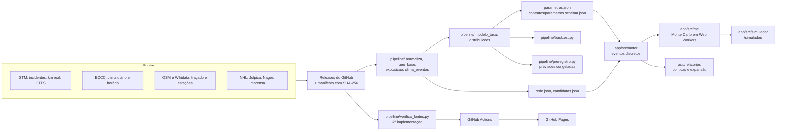

# Arquitetura e manutenção

Para quem vai mexer no código. O que cada parte faz, por onde os dados passam, como testar e como publicar. As decisões e os motivos estão em [`decisoes/registro_de_decisoes.md`](decisoes/registro_de_decisoes.md).

> **Revisão de 2026-11 (após a ressegmentação).** As falhas passaram a ser separadas por frota (MR-73, MPM-10) e por setor do equipamento fixo, a duração segue a faixa oficial da STM quando a calculada pelos horários a contradiz, e a exposição é medida em todo o período (km real republicado pela STM em 2026-10-23). Specs 017 a 020; decisões D55 a D63. A versão anterior continua em [`/versoes/v1.1.0/`](https://felipe44776-eseg.github.io/confiabilidade-metro-montreal/versoes/v1.1.0/), e cada número que mudou está em [`revisao_2026-11.md`](../fontes/verificacao/revisao_2026-11.md).

## Visão geral



## Pastas

| Pasta | Conteúdo | Linguagem |
|---|---|---|
| `pipeline/` | Do dado bruto ao `parametros.json`, mais o backtest e a verificação independente. Módulos comuns da revisão de 2026-11: `duracao.py` (regra da faixa oficial e classes de gravidade, usada pela normalização, pelo painel e, reimplementada, pela verificação) e `km_real.py` (leitor dos dois formatos do km real) | Python 3.11, versões em `pipeline/requirements.txt` |
| `pipeline/tests/` | Critérios de aceite das specs como testes (`pytest`) | Python |
| `contratos/` | Esquema JSON do contrato entre pipeline e simulador | JSON Schema |
| `app/src/motor/` | Motor de eventos discretos: rede, taxas, falhas, frota, políticas, grafo, expansão | TypeScript |
| `app/src/mc/` | Rodadas, agregação com IC 95%, pool de Web Workers | TypeScript |
| `app/src/simulador/`, `app/src/ui/` | Página `/simulador/`: mapa, animação, cenário no link, peso de cada variável com a nota do método (`pesos.ts`), viagem de A a B (`pool_viagem.ts`; cálculo em `app/src/motor/viagem.ts`, spec 015) com linhas novas (`app/src/motor/linhas_novas.ts`, spec 016), escala para confiabilidade alta (`app/src/ui/escala.ts`), comparação, expansão | TypeScript + MapLibre |
| `app/tests/` | Testes do motor e da interface (`vitest`) | TypeScript |
| `app/relatorios/` | Relatórios que rodam o motor com os dados reais (`vitest.relatorios.config.ts`) | TypeScript |
| `painel/` | Painel de confiabilidade (página única com d3 7.9.0 embutido) | Python + HTML |
| `publicacao/` | Montagem do site em `_site/` | Python |
| `dados/derivados/` | Tudo o que o pipeline gera; versionado e com hash no manifesto | CSV, JSON, GeoJSON |
| `dados/manuais/` | Tabelas montadas à mão, uma URL por linha | CSV |
| `fontes/` | Documentação das fontes, manifesto, relatórios de verificação e validação | Markdown, JSON |
| `specs/` | Especificações (spec, plan, tasks) e constituição | Markdown |

## Ordem do pipeline

Cada script lê só o que os anteriores gravaram. A ordem é a mesma do `reproduz.yml`:

```bash
python -I pipeline/verifica_fontes.py --baixa-release --baixa-origem --completo
python -I pipeline/extrai_gtfs_metro.py dados/brutos/gtfs/gtfs_stm_mdb-2126_latest.zip
python -I pipeline/extrai_mobilidade.py dados/brutos/google/google_Region_Mobility_Report_CSVs.zip
python -I pipeline/monta_painel.py            # painel diário
python -I pipeline/analise_confiabilidade.py  # 17 tabelas do painel
python -I pipeline/geo_base.py                # traçado, estações, locais (spec 002)
python -I pipeline/normaliza.py               # eventos, fontes e durações (specs 001 e 017)
python -I pipeline/exposicao.py               # exposição e parcela da frota (specs 004 e 018)
python -I pipeline/baixa_clima_eventos.py     # pula o ECCC se o zip da Release existe
python -I pipeline/clima_eventos.py           # painel horário (spec 003)
python -I pipeline/horario_simulador.py       # rede.json
python -I pipeline/candidatas.py              # candidatas.json (spec 014)
python -I pipeline/modelo_taxa.py             # specs 005 e 018: famílias e fontes, bootstrap B = 200, ~80 min
python -I pipeline/diagnostico_taxa.py
python -I pipeline/fora_da_amostra.py         # spec 018: um ano de fora, v1.1.0 contra o modelo por fonte
python -I pipeline/distribuicoes.py           # specs 006 e 018
python -I pipeline/parametros.py              # contrato do simulador (v2)
python -I pipeline/backtest.py                # specs 012 e 020, B = 100, ~20 min
cd app && npx vitest run --config vitest.relatorios.config.ts   # políticas, expansão, viagem, linhas novas e revalidação
cd .. && python -I pipeline/compara_versoes.py                 # antes e depois da revisão de 2026-11
```

**Memória:** rode `modelo_taxa`, `distribuicoes` e `backtest` um de cada vez. Juntos passam de 4 GB. O bootstrap coleta o lixo a cada réplica: o statsmodels guarda um ciclo de referências entre o modelo e o resultado, e sem a coleta cada réplica do painel empilhado (até cerca de 200 MB) fica presa na memória.

**Pré-registro (spec 020):** `python -I pipeline/preregistro.py congela v2` congela o modelo revisto e grava `fontes/verificacao/preregistro/modelo_v2.json`; o commit desse arquivo vem antes de qualquer download de incidentes novos. `preregistro.py avalia v1` (ou `v2`) só roda quando a STM tiver publicado pelo menos 3 meses depois de 2026-06.

## O contrato `parametros.json`

É a única ponte entre o Python e o TypeScript. Cada número é um objeto `{valor, ic95, n, unidade, metodo, fontes, script, status}`. Partes principais:

| Chave | O que é | De onde vem |
|---|---|---|
| `versao` | `2` desde a revisão de 2026-11; o motor ainda lê o contrato `1` (v1.1.0) com os mesmos números | `parametros.py` |
| `fontes[]` | Contrato v2 (spec 018): 9 fontes, cada uma com `id`, `familia` (`MR` para trem, `EF` para trecho), `rotulo` e status do rótulo, modelo, α, multiplicadores e, por linha, `base_por_trem_hora` (já multiplicada pela parcela da frota), `renovacao` e `ttr`. A ordem do arquivo é a ordem do sorteio; falta de `renovacao` ou de `ttr` é erro | `modelo_taxa.py`, `distribuicoes.py`, `parametros.py` |
| `frota_por_linha` | Parcela dos km de cada frota em cada linha no ano-base, com status (para o cenário futuro, spec 022) | `exposicao.py` |
| `taxas.MR`, `taxas.EF` | Taxa-base por trem-hora de cada linha e multiplicadores por fator, por família (o peso de cada variável na página usa a família) | `modelo_taxa.py` |
| `renovacao` | Forma e escala da Weibull no tempo reescalado, por linha e família | `distribuicoes.py` |
| `ttr` | Massa em zero, lognormal e `amostra_positivos` (o sorteio usa a amostra), por linha e família | `distribuicoes.py` + `parametros.py` |
| `causa_comum` | Um grupo por conjunto de linhas paradas juntas, com taxa e duração | `distribuicoes.py` |
| `causa_comum_beta` | Fator β por par (só relatório) | `distribuicoes.py` |
| `locais_ef` | Onde ocorrem as falhas de equipamento fixo (km na linha, peso) | `parametros.py` |
| `frota` | Trens necessários e taxa de falha por trem-dia | painel |
| `hipoteses` | Tudo o que não tem dado, com faixa | `parametros.py` |

Mudar o formato exige mudar o esquema em `contratos/`, o `parametros.py`, os tipos em `app/src/motor/tipos.ts` e o teste do contrato em `pipeline/tests/test_modelos.py`.

## Testes

```bash
python -m pytest pipeline/tests -q                  # 69 testes em 2026-11-11: critérios das specs 001 a 006, 012, 013, 017, 018 e 020
cd app && npm test                                  # 140 testes em 2026-11-11: motor e interface
python -I pipeline/verifica_fontes.py --recalcula   # 38 números recalculados direto dos brutos (25 até a v1.1.0)
```

Teste no navegador (opcional, fora do CI): `publicacao/testa_navegador.py` abre o simulador publicado num Edge ou Chrome sem janela, em tamanho de celular e de notebook, e mede rolagem lateral, WebGL, quadros por segundo (com a animação parada e tocando a 300×, 1 h/s, 10 h/s e 1 dia/s, contados por `requestAnimationFrame` com a aba na frente, com a ocupação da thread da página em cada velocidade), o resultado do Monte Carlo de abertura e erros no console; a 1 dia/s conta os eventos vermelhos, os dias emendados e o placar, e depois muda o clima e confere que a faixa "Cenário aplicado" e o peso da neve no solo mudaram; abre a nota do método e captura o painel do cenário; roda a viagem padrão da aba "Viagem de A a B" e lê as tabelas; por fim, marca a Linha Rosa, desenha uma linha pela lista, avalia a viagem com as linhas novas e lê a comparação. As falhas esperadas por dia vêm de `app/src/simulador/efeito.ts`, pela mesma taxa acumulada que o motor sorteia. Precisa de `websocket-client` num ambiente à parte. Rode um tamanho por vez (`SO=celular`, depois `SO=notebook`).

Todos rodam a cada publicação. Um teste novo para cada critério de aceite novo.

## Publicação

| Workflow | Quando | O que faz |
|---|---|---|
| `deploy.yml` | push na `main` | Baixa as Releases, confere hashes, recalcula, roda pytest e vitest, monta e publica; erro impede a publicação; inclui as versões congeladas em `/versoes/` |
| `verifica-fontes.yml` | toda segunda-feira | Baixa cada fonte da origem e grava o relatório datado; mudança é aviso |
| `reproduz.yml` | só sob pedido (agenda mensal desligada em 2026-11-11, D65) | Refaz tudo do zero e compara com os publicados (`compara_derivados.py`); não refeito depois da revisão de 2026-11 |

**Antes de qualquer push:** conta `felipe44776-eseg` (`GH_CONFIG_DIR=~/.config/gh-esg`) e e-mail da ESEG. Depois de regerar qualquer arquivo em `dados/derivados/`: `python -I pipeline/verifica_fontes.py --gera-manifesto`.

**Dado novo:** baixe, crie uma Release nova com data no nome (as antigas não mudam), acrescente a fonte em `FONTES` dentro de `verifica_fontes.py` com a `release_tag`, regere o manifesto e documente em `fontes/FONTES.md`.

**Versão congelada:** build com `VITE_BASE=/confiabilidade-metro-montreal/versoes/<etiqueta>/` (no Git Bash, com `MSYS_NO_PATHCONV=1`), `monta_site.py`, zip de `_site/` como `site-<etiqueta>.zip` numa Release com a etiqueta.

## Agente crítico

`.claude/agents/critico-stf.md` define um revisor que roda os testes, confere cada número dos documentos contra os arquivos gerados e procura defeitos. Ele grava um relatório datado em `fontes/verificacao/critica_<data>.md` e só corrige o que o próprio teste confirma. Use-o antes de uma entrega.
