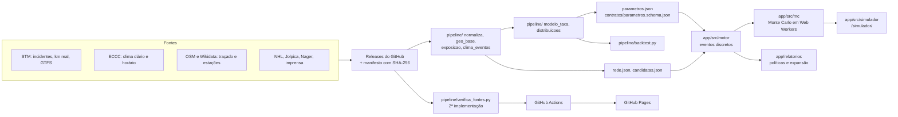

# Arquitetura e manutenção

Para quem vai mexer no código. O que cada parte faz, por onde os dados passam, como testar e como publicar. As decisões e os motivos estão em [`decisoes/registro_de_decisoes.md`](decisoes/registro_de_decisoes.md).

## Visão geral



## Pastas

| Pasta | Conteúdo | Linguagem |
|---|---|---|
| `pipeline/` | Do dado bruto ao `parametros.json`, mais o backtest e a verificação independente | Python 3.11, versões em `pipeline/requirements.txt` |
| `pipeline/tests/` | Critérios de aceite das specs como testes (`pytest`) | Python |
| `contratos/` | Esquema JSON do contrato entre pipeline e simulador | JSON Schema |
| `app/src/motor/` | Motor de eventos discretos: rede, taxas, falhas, frota, políticas, grafo, expansão | TypeScript |
| `app/src/mc/` | Rodadas, agregação com IC 95%, pool de Web Workers | TypeScript |
| `app/src/simulador/`, `app/src/ui/` | Página `/simulador/`: mapa, animação, cenário no link, comparação, expansão | TypeScript + MapLibre |
| `app/tests/` | Testes do motor e da interface (`vitest`) | TypeScript |
| `app/relatorios/` | Relatórios que rodam o motor com os dados reais (`vitest.relatorios.config.ts`) | TypeScript |
| `painel/` | Painel de confiabilidade (página única com d3 7.9.0 embutido) | Python + HTML |
| `publicacao/` | Montagem do site em `_site/` | Python |
| `dados/derivados/` | Tudo o que o pipeline gera; versionado e com hash no manifesto | CSV, JSON, GeoJSON |
| `dados/manuais/` | Tabelas montadas à mão, uma URL por linha | CSV |
| `fontes/` | Documentação das fontes, manifesto, relatórios de verificação e validação | Markdown, JSON |
| `specs/` | Especificações (spec, plan, tasks) e constituição | Markdown |

## Ordem do pipeline

Cada script lê só o que os anteriores gravaram. A ordem é a mesma do `reproduz.yml`:

```bash
python -I pipeline/verifica_fontes.py --baixa-release --baixa-origem --completo
python -I pipeline/extrai_gtfs_metro.py dados/brutos/gtfs/gtfs_stm_mdb-2126_latest.zip
python -I pipeline/extrai_mobilidade.py dados/brutos/google/google_Region_Mobility_Report_CSVs.zip
python -I pipeline/monta_painel.py            # painel diário
python -I pipeline/analise_confiabilidade.py  # 17 tabelas do painel
python -I pipeline/geo_base.py                # traçado, estações, locais (spec 002)
python -I pipeline/normaliza.py               # eventos (spec 001)
python -I pipeline/exposicao.py               # exposição (spec 004)
python -I pipeline/baixa_clima_eventos.py     # pula o ECCC se o zip da Release existe
python -I pipeline/clima_eventos.py           # painel horário (spec 003)
python -I pipeline/horario_simulador.py       # rede.json
python -I pipeline/candidatas.py              # candidatas.json (spec 014)
python -I pipeline/modelo_taxa.py             # spec 005, ~20 min, 3 GB
python -I pipeline/diagnostico_taxa.py
python -I pipeline/distribuicoes.py           # spec 006, ~10 min
python -I pipeline/parametros.py              # contrato do simulador
python -I pipeline/backtest.py                # spec 012, ~40 min
cd app && npx vitest run --config vitest.relatorios.config.ts   # políticas e expansão
```

**Memória:** rode `modelo_taxa`, `distribuicoes` e `backtest` um de cada vez. Juntos passam de 4 GB.

## O contrato `parametros.json`

É a única ponte entre o Python e o TypeScript. Cada número é um objeto `{valor, ic95, n, unidade, metodo, fontes, script, status}`. Partes principais:

| Chave | O que é | De onde vem |
|---|---|---|
| `taxas.MR`, `taxas.EF` | Taxa-base por trem-hora de cada linha e multiplicadores por fator | `modelo_taxa.py` |
| `renovacao` | Forma e escala da Weibull no tempo reescalado, por linha e causa | `distribuicoes.py` |
| `ttr` | Massa em zero, lognormal e `amostra_positivos` (o sorteio usa a amostra) | `distribuicoes.py` + `parametros.py` |
| `causa_comum` | Um grupo por conjunto de linhas paradas juntas, com taxa e duração | `distribuicoes.py` |
| `causa_comum_beta` | Fator β por par (só relatório) | `distribuicoes.py` |
| `locais_ef` | Onde ocorrem as falhas de equipamento fixo (km na linha, peso) | `parametros.py` |
| `frota` | Trens necessários e taxa de falha por trem-dia | painel |
| `hipoteses` | Tudo o que não tem dado, com faixa | `parametros.py` |

Mudar o formato exige mudar o esquema em `contratos/`, o `parametros.py`, os tipos em `app/src/motor/tipos.ts` e o teste do contrato em `pipeline/tests/test_modelos.py`.

## Testes

```bash
python -m pytest pipeline/tests -q                  # 55 testes: critérios das specs 001 a 006, 012 e 013
cd app && npm test                                  # 87 testes: motor e interface
python -I pipeline/verifica_fontes.py --recalcula   # 25 números recalculados direto dos brutos
```

Teste no navegador (opcional, fora do CI): `publicacao/testa_navegador.py` abre o simulador publicado num Edge ou Chrome sem janela, em tamanho de celular e de notebook, e mede rolagem lateral, WebGL, quadros por segundo (com a animação parada e tocando a 300×, contados por `requestAnimationFrame` com a aba na frente), o resultado do Monte Carlo de abertura e erros no console. Precisa de `websocket-client` num ambiente à parte. Rode um tamanho por vez (`SO=celular`, depois `SO=notebook`).

Todos rodam a cada publicação. Um teste novo para cada critério de aceite novo.

## Publicação

| Workflow | Quando | O que faz |
|---|---|---|
| `deploy.yml` | push na `main` | Baixa as Releases, confere hashes, recalcula, roda pytest e vitest, monta e publica; erro impede a publicação; inclui as versões congeladas em `/versoes/` |
| `verifica-fontes.yml` | toda segunda-feira | Baixa cada fonte da origem e grava o relatório datado; mudança é aviso |
| `reproduz.yml` | todo dia 1 e sob pedido | Refaz tudo do zero e compara com os publicados (`compara_derivados.py`) |

**Antes de qualquer push:** conta `felipe44776-eseg` (`GH_CONFIG_DIR=~/.config/gh-esg`) e e-mail da ESEG. Depois de regerar qualquer arquivo em `dados/derivados/`: `python -I pipeline/verifica_fontes.py --gera-manifesto`.

**Dado novo:** baixe, crie uma Release nova com data no nome (as antigas não mudam), acrescente a fonte em `FONTES` dentro de `verifica_fontes.py` com a `release_tag`, regere o manifesto e documente em `fontes/FONTES.md`.

**Versão congelada:** build com `VITE_BASE=/confiabilidade-metro-montreal/versoes/<etiqueta>/` (no Git Bash, com `MSYS_NO_PATHCONV=1`), `monta_site.py`, zip de `_site/` como `site-<etiqueta>.zip` numa Release com a etiqueta.

## Agente crítico

`.claude/agents/critico-stf.md` define um revisor que roda os testes, confere cada número dos documentos contra os arquivos gerados e procura defeitos. Ele grava um relatório datado em `fontes/verificacao/critica_<data>.md` e só corrige o que o próprio teste confirma. Use-o antes de uma entrega.
