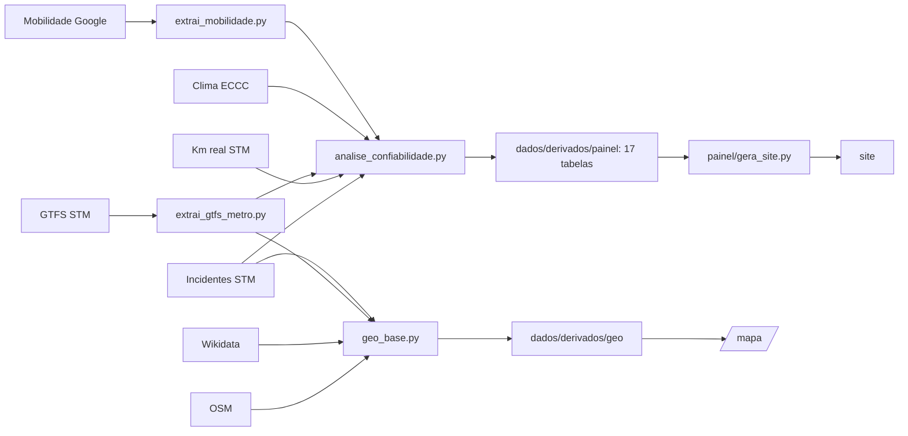

# Fontes de dados e rastreabilidade

Projeto: confiabilidade e tolerância a falhas do metrô de Montreal (disciplina Sistemas Tolerantes a Falhas, Engenharia de Produção, ESEG).
Todo número publicado vem dos arquivos listados aqui, e qualquer pessoa pode conferir.

- Site: https://felipe44776-eseg.github.io/confiabilidade-metro-montreal/
- Hashes completos: [`fontes_manifesto.json`](fontes_manifesto.json)
- Dados brutos, cópia exata: Releases [`dados-2026-10-20`](https://github.com/felipe44776-eseg/confiabilidade-metro-montreal/releases/tag/dados-2026-10-20) (fase 0) e [`dados-2026-10-21`](https://github.com/felipe44776-eseg/confiabilidade-metro-montreal/releases/tag/dados-2026-10-21) (fase 1: clima horário e expansão)
- Colunas de cada tabela derivada e fatores sem fonte: [`../docs/dicionario_dados.md`](../docs/dicionario_dados.md)

## Como conferir sozinho

Com Python 3.11 e nenhuma biblioteca extra, na raiz do repositório:

```bash
python -I pipeline/verifica_fontes.py --baixa-release --recalcula   # baixa os dados da Release e confere tudo
python -I pipeline/verifica_fontes.py --online                      # compara com a fonte original hoje
```

| Verificação | O que faz |
|---|---|
| Integridade | Compara o SHA-256 de cada arquivo com o manifesto |
| `--baixa-release` | Baixa os dados brutos da Release do GitHub e confere cada hash |
| `--online` | Baixa de novo cada fonte na origem e diz se o conteúdo é idêntico ao que usamos |
| `--recalcula` | Refaz, direto dos dados brutos, 25 números publicados, com código próprio que não usa os scripts de análise |

O site é publicado por GitHub Actions. Cada publicação roda `--baixa-release --recalcula`, e um erro impede a publicação. O resultado da última execução aparece em https://felipe44776-eseg.github.io/confiabilidade-metro-montreal/fontes/.

**Resultado local em 2026-10-21:**
- 0 problemas de integridade.
- 25 números recalculados, sem nenhuma diferença (18 da fase 0 e 7 da fase 1: eventos normalizados, falhas depois da meia-noite, trens às 08:00 nas 4 linhas e horas de chuva congelante).
- Em 2026-10-20, as 27 fontes então registradas foram baixadas de novo: 26 vieram idênticas byte a byte; a 27ª (mobilidade do Google, 98 MB) foi conferida pelo tamanho.

## 1. Fontes que alimentam o painel e o simulador

Acesso a todas: 2026-10-20. Hash completo no manifesto.

| Fonte | Editor e licença | Download | Arquivo | Tamanho e linhas | SHA-256 (início) | Na Release? |
|---|---|---|---|---|---|---|
| Incidentes do metrô | STM, CC BY 4.0 | https://donneesouvertes.stm.info/fichiers/Incidents%20m%C3%A9tro.csv | `dados/brutos/stm/incidents_metro.csv` | 7.954.389 bytes; 45.785 incidentes | `03baafef3cc66739` | sim |
| Quilometragem real das voitures | STM, CC BY 4.0 | https://donneesouvertes.stm.info/fichiers/Kilom%C3%A9trage%20r%C3%A9el.csv | `dados/brutos/stm/km_reel.csv` | 56.529.490 bytes; 559.549 registros | `40b21aca5f136c10` | sim |
| GTFS da STM | STM, CC BY 4.0; espelho do Mobility Database | https://files.mobilitydatabase.org/mdb-2126/latest.zip | `dados/brutos/gtfs/gtfs_stm_mdb-2126_latest.zip` | 66.986.453 bytes; versão `20261007130000_26N` | `50c8481c9f67de78` | sim |
| Traçado das linhas e estações | Colaboradores do OpenStreetMap, ODbL 1.0 | Overpass API (consulta no manifesto) | `dados/brutos/osm/overpass_metro_mtl.json` | 8 relações `route=subway`, 69 estações; base OSM de 2026-10-21 01:07 UTC | ver manifesto | sim |
| Coordenadas das estações (2ª referência) | Wikidata, CC0 | SPARQL em https://query.wikidata.org (consulta no manifesto) | `dados/brutos/wikidata/estacoes_metro_mtl.json` | 102 registros da rede Q392377 | ver manifesto | sim |
| Clima diário, 2019 a 2026 (8 arquivos) | Environment and Climate Change Canada, Licença de Governo Aberto do Canadá | `https://climate.weather.gc.ca/climate_data/bulk_data_e.html?format=csv&stationID=51157&Year=ANO&Month=1&Day=1&time=&timeframe=2&submit=Download+Data` | `dados/brutos/eccc/eccc_diario_ANO.csv` | 62 a 65 KB por ano | ver manifesto | sim |
| Mobilidade em estações de transporte | Google LLC | https://www.gstatic.com/covid19/mobility/Region_Mobility_Report_CSVs.zip | `dados/brutos/google/…` | 98.167.694 bytes; Montreal: 974 dias | `303a1d7ba631c1e6` | não: baixar da origem |

### Incidentes do metrô (a base principal)

- **Onde a STM publica:**
  - fichas nos catálogos https://www.donneesquebec.ca/recherche/dataset/vmtl-incidents-du-reseau-du-metro e https://donnees.montreal.ca/dataset/incidents-du-reseau-du-metro;
  - o arquivo fica em `donneesouvertes.stm.info`.
- **Como achamos:** pela API do Données Québec, que lista os 7 conjuntos da STM, nenhum deles de passageiros:
  `https://www.donneesquebec.ca/recherche/api/3/action/package_search?fq=organization:societe-de-transport-de-montreal`.
- **Formato:**
  - CSV com `;`;
  - a 1ª linha é um aviso e o cabeçalho vem na 2ª;
  - 26 colunas, entre elas `Cause primaire`, `Cause secondaire`, `Ligne`, `Heure de l'incident`, `Heure de reprise`, `Incident en minutes`, `Véhicule`, `Code de lieu`, `Jour calendaire`.
- **Particularidades conferidas:**
  - Depois da meia-noite a hora continua como 24:xx e 25:xx (dia de operação).
  - A hora de retomada não tem data.
  - A duração calculada cai dentro da faixa oficial `Incident en minutes` em **97,5%** dos eventos técnicos (8.319 de 8.530 exatos, `na_faixa` em `resumo_normalizacao.json`; 97,95% com tolerância de 1 minuto: conferência pontual, sem arquivo gerado, refeita de `eventos_tecnicos.csv` na revisão crítica de 2026-10-21, rodada 2).
- **Falha técnica:** causa primária "Matériel roulant" ou "Équipements fixes".
  - Total: **8.619**, das quais **8.530** são de uma linha só e entram nas métricas por linha.
  - Ficam fora **44** sem linha ("Non affecté").
  - Outras **45** foram registradas em mais de uma linha e entram como causa comum.

### Quilometragem real

- **Ficha:** https://donnees.montreal.ca/dataset/stm-kilometrage-realise-par-les-voitures-de-metro-de-la-stm
- **Formato:** uma linha por composição, por linha e por dia, de 2019-01-01 a 2023-09-30.
- **Total:** 411,63 milhões de km-carro.
- **Frotas:** 73 = MR-73 e 10 = MPM-10. **22 registros** de material tipo **63** (15,7 km) entram no total, mas em nenhuma das duas frotas; o efeito é desprezível.

### GTFS da STM

- **Por que o espelho:** o endereço original, https://www.stm.info/sites/default/files/gtfs/gtfs_stm.zip, não respondeu desta máquina (o stm.info recusa a conexão). Usamos o espelho do Mobility Database, feed `mdb-2126`, cujo catálogo registra como origem o endereço da STM.
- **Extração:** `pipeline/extrai_gtfs_metro.py` gera a sequência de estações das linhas 1, 2, 4 e 5 (27, 31, 3 e 12 estações). Rodar de novo dá arquivos idênticos.

### Traçado (OpenStreetMap) e coordenadas (Wikidata)

- **OSM:** uma consulta à Overpass API trouxe as 8 relações `route=subway` (2 por linha) e os 69 nós de estação.
- **Comprimento:** `pipeline/geo_base.py` encadeia as vias de cada linha e chega a 22,11 / 29,36 / 4,29 / 9,73 km. O oficial é 22,1 / 30,0 / 4,25 / 9,7 km, todos dentro de ±3%.
- **Wikidata:** a consulta SPARQL busca as estações da rede Q392377.
- **Resultado completo:** [`verificacao/validacao_geo.md`](verificacao/validacao_geo.md).

### Clima diário

- **Estação:** MONTREAL INTL A, `stationID=51157`, Climate ID 7025251, conferido no próprio arquivo.
- **Atenção:** o servidor às vezes devolve HTML no lugar do CSV. O arquivo certo começa com `"Longitude`.

### Mobilidade do Google

- **Distribuição:** não vai na Release, porque a redistribuição não foi verificada. Baixe da origem.
- **Extração:** `pipeline/extrai_mobilidade.py` reproduz o recorte de Montreal (`dados/derivados/mobilidade/`) idêntico.

### Fontes da fase 1: clima horário, eventos externos e expansão (acesso em 2026-10-21)

Release [`dados-2026-10-21`](https://github.com/felipe44776-eseg/confiabilidade-metro-montreal/releases/tag/dados-2026-10-21) para o que pode ser redistribuído. Download: `pipeline/baixa_clima_eventos.py`.

| Fonte | Editor e licença | Download | Arquivo | Tamanho | SHA-256 (início) | Na Release? |
|---|---|---|---|---|---|---|
| Clima horário, McTavish (precipitação), 90 meses | ECCC, Licença de Governo Aberto do Canadá | `bulk_data_e.html?format=csv&stationID=10761&Year=ANO&Month=MES&Day=1&timeframe=1&submit=Download+Data` | `dados/brutos/eccc_horario/eccc_horario_10761.zip` | 1.151.412 bytes | `fc951ce9d2d895fc` | sim |
| Clima horário, aeroporto 30165 (precipitação de reserva) | ECCC, idem | mesmo endereço com `stationID=30165` | `dados/brutos/eccc_horario/eccc_horario_30165.zip` | 1.202.307 bytes | `00620be3f361099a` | sim |
| Clima horário, MONTREAL INTL A 51157 (temperatura, vento, condição) | ECCC, idem | mesmo endereço com `stationID=51157` | `dados/brutos/eccc_horario/eccc_horario_51157.zip` | 1.294.909 bytes | `87977d0f6cabdefd` | sim |
| Calendário do Canadiens, 8 temporadas | NHL (API pública não documentada); redistribuição não verificada | `https://api-web.nhle.com/v1/club-schedule-season/MTL/TEMPORADA` | `dados/brutos/eventos/nhl_MTL_*.json` | 1.330.464 bytes no total | ver manifesto | não: baixar da origem |
| GP do Canadá | Jolpica (sucessora comunitária da Ergast); licença não verificada | `https://api.jolpi.ca/ergast/f1/circuits/villeneuve/races.json?limit=100` | `dados/brutos/eventos/f1_villeneuve.json` | 20.467 bytes | `89ebe47cf33352de` | não: baixar da origem |
| Greves da STM em 2025 | Tabela do projeto; uma URL de imprensa por linha | — | `dados/manuais/greves_stm.csv` | 6.520 bytes; 25 dias | `c16d709eeefdf1ae` | no repositório |
| Metrô em obras ou proposto | Colaboradores do OpenStreetMap, ODbL 1.0 | Overpass API (consulta no manifesto) | `dados/brutos/osm/overpass_expansao.json` | 16.487 bytes; base OSM de 2026-10-21 02:09 UTC | `3f895b2ab8ccd317` | sim |

- **Clima horário:** os 90 CSV mensais de cada estação vão num zip com data e ordem fixas, então o hash é o mesmo a cada geração. O `--online` baixa dois meses de amostra (2019-01 e 2025-12) e compara com o arquivo dentro do zip.
- **Hora:** o ECCC publica em hora padrão local (LST, UTC−5 o ano todo). A conversão para a hora de Montreal tem teste nos dias de troca de horário (spec 003).
- **Chuva congelante:** o episódio de 2023-04-05 (09h a 20h LST) aparece nas 12 horas; o recálculo independente confere direto no CSV do ECCC.
- **Greves:** as faixas com serviço vêm da imprensa e ficam com status "não verificado" até haver fonte oficial.

## 2. Outras fontes baixadas

| Fonte | Link | Arquivo | Uso | Na Release? |
|---|---|---|---|---|
| Km planejado da STM | https://donneesouvertes.stm.info/fichiers/Kilom%C3%A9trage%20m%C3%A9tro%20planif%C3%A9.csv | `dados/brutos/stm/km_planifie.csv` | Painel diário (tipo de dia da STM) | sim |
| Km orçado da STM | https://donneesouvertes.stm.info/fichiers/Kilom%C3%A9trage%20m%C3%A9tro%20budg%C3%A9t%C3%A9.csv | `dados/brutos/stm/km_budgete.csv` | Descartado (cada linha do arquivo vem entre aspas) | sim |
| Feriados | `https://date.nager.at/api/v3/PublicHolidays/ANO/CA` | `dados/brutos/nager/` | Painel diário | não (licença não verificada) |
| Relatórios de atividade da STM, 2019 a 2023 | cópias do Internet Archive (endereços no manifesto) | `dados/brutos/stm_relatorios/` | Totais anuais de entradas (283,5 milhões em 2019) | não |
| d3 7.9.0 | https://cdn.jsdelivr.net/npm/d3@7.9.0/dist/d3.min.js | `painel/vendor/d3.v7.9.0.min.js` | Gráficos do painel | no repositório (licença ISC) |

## 3. APIs e serviços acessados

| Serviço | Endereço | Para quê | Resultado |
|---|---|---|---|
| Catálogo Données Québec (CKAN) | `https://www.donneesquebec.ca/recherche/api/3/action/package_search` | Listar os conjuntos da STM | **Usado**: 7 conjuntos |
| Catálogo Ville de Montréal (CKAN) | `https://donnees.montreal.ca/api/3/action/package_search` | Procurar passageiros | Nada diário |
| Arquivos da STM | `https://donneesouvertes.stm.info/fichiers/...` | Incidentes e quilometragem | **Usado** |
| Site da STM | `https://www.stm.info` | Relatórios e GTFS original | Sem conexão desta máquina |
| Mobility Database | `https://files.mobilitydatabase.org/feeds_v2.csv` e `.../mdb-2126/latest.zip` | GTFS | **Usado** |
| Overpass API (OpenStreetMap) | `https://overpass-api.de/api/interpreter` | Traçado e estações | **Usado** |
| Wikidata (SPARQL e busca) | `https://query.wikidata.org/sparql` e `https://www.wikidata.org/w/api.php` | Coordenadas de referência | **Usado** |
| Environment and Climate Change Canada | `https://climate.weather.gc.ca/climate_data/bulk_data_e.html` | Clima | **Usado** |
| Google Mobility | `https://www.gstatic.com/covid19/mobility/` | Mobilidade | **Usado** |
| Nager.Date | `https://date.nager.at/api/v3/PublicHolidays/` | Feriados | Painel diário |
| Internet Archive (CDX e cópias) | `http://web.archive.org/cdx/search/cdx` e `https://web.archive.org/web/<data>id_/<url>` | Relatórios antigos (STM, Metrô SP, CPTM) | Usado |
| Wikipedia (fr) | https://fr.wikipedia.org/wiki/M%C3%A9tro_de_Montr%C3%A9al | Comprimento oficial das linhas | Usado na validação |
| API da NHL | `https://api-web.nhle.com/v1/club-schedule-season/MTL/` | Jogos do Canadiens em casa | **Usado** (spec 003) |
| Jolpica F1 | `https://api.jolpi.ca/ergast/f1/` | Datas do GP do Canadá | **Usado** (spec 003) |
| Imprensa de Montreal (Noovo, Time Out e outras) | URLs em `dados/manuais/greves_stm.csv` | Faixas com serviço nas greves de 2025 | **Usado** (spec 003), status "não verificado" |
| Zenodo | `https://zenodo.org/api/records/17855209` | Plano B (Heavy Clay) | Pesquisa |
| Portal de transparência do Metrô SP, ARTESP, API Direto dos Trens, GitHub, Kaggle | ver histórico do projeto | Pesquisa sobre São Paulo e outras bases | Sem série de falhas utilizável |

## 4. De onde vem cada número



| Parte | Arquivo | Vem de |
|---|---|---|
| Indicadores por linha, MTBF, MTTR, disponibilidade, dias sem falha | `painel/linhas.json`, `painel/anual.json` | Incidentes; km real nas taxas por km |
| Distribuições e ajustes do tempo entre falhas | `painel/tbf_*.json`, `painel/ajustes.json` | Incidentes |
| Frota e Pareto de veículos | `painel/frota_anual.json`, `painel/pareto.json` | Incidentes + km real |
| Hora, mês, temperatura, neve, correlações | `painel/perfil.json`, `painel/correlacoes.json` | Incidentes + km real + clima + mobilidade |
| Causa comum, corredor, simulação, k-de-n | `painel/causa_comum.json`, `corredor.json`, `sim_*.json`, `kdn.json` | Incidentes (+ km real no k-de-n). **O tempo de reparo do k-de-n é hipótese** |
| Traçado, estações com km ao longo da linha, locais dos incidentes | `geo/linhas.geojson`, `geo/estacoes.geojson`, `geo/locais.json` | OSM + GTFS + Wikidata + incidentes |
| Eventos normalizados, exposição por hora e frota, painel horário de clima e eventos | `eventos/`, `exposicao/`, `clima/` | Incidentes; GTFS + km real + greves; ECCC horário + NHL + Jolpica + Nager (specs 001, 003, 004) |
| Multiplicadores da taxa de falha e comparação MR contra EF | `modelos/taxa_MR.json`, `taxa_EF.json`, `comparacao_mr_ef.json`; relatório `verificacao/modelo_taxa.md` | Eventos + exposição + clima (spec 005) |
| Distribuições do tempo entre falhas, reescala, tempo até restabelecer, causa comum | `modelos/distribuicoes.json`; relatório `verificacao/distribuicoes.md` | Eventos + falha esperada da spec 005 (spec 006) |
| Parâmetros do simulador | `simulador/parametros.json` (contrato `contratos/parametros.schema.json`) | Specs 005 e 006 + painel (frota); hipóteses marcadas |
| Horário e rede do simulador; linhas candidatas | `simulador/rede.json`, `simulador/candidatas.json` | GTFS + spec 002; tabela manual de candidatas (OSM, Wikidata, documentos públicos) |
| Validação contra o histórico | `modelos/backtest.json`; relatório `verificacao/backtest.md` | Mesmas fontes da spec 005, com treino até o corte (spec 012) |
| Efeito das políticas e minutos por ano do simulador | `simulador/politicas.json`; relatório `verificacao/politicas.md` | Motor do simulador com `parametros.json` (specs 008 e 009). **O reparo na oficina e os tempos de retirada e de marcha lenta são hipóteses** |

## 5. Auditoria independente (2026-10-20)

Um agente sem acesso aos scripts do projeto recebeu só os links e o documento e tentou refutar os números com código próprio. Não achou nenhuma divergência numérica.

| Afirmação | Como foi verificada | Resultado |
|---|---|---|
| CSV de incidentes: formato, colunas, período, hash | Download próprio e SHA-256 | Confirmado: 7.954.389 bytes, hash igual, 26 colunas, 2019-01-01 a 2026-06-30 |
| CSV de km real | Idem | Confirmado: 56.529.490 bytes, 559.549 registros, até 2023-09-30 |
| GTFS, clima (8 arquivos), mobilidade | Download e hash | Confirmado: todos iguais ao manifesto |
| 8.530 falhas técnicas e contagem por linha | Filtro próprio | Confirmado: Verde 2.826, Laranja 3.088, Amarela 1.146, Azul 1.470 |
| MTBF da rede, 6,42 h | 2.738 dias × 20 h / 8.530 | Confirmado: 6,4197 h |
| Km-carro por falha: MR-73 60.595, MPM-10 372.008 | Soma própria do km real | Confirmado: 60.595,5 e 372.007,6, com os 10 valores anuais |
| 31 incidentes técnicos nas linhas 1 e 2 | Filtro do campo `Ligne` | Confirmado: 30 de equipamentos fixos e 1 de material rodante |
| Coordenadas de 6 estações | Wikipedia e Nominatim | Confirmado: todas a menos de 100 m |
| Página pública | Extração de `window.DADOS` | Confirmado: as 17 tabelas são idênticas às locais |
| A API lista 7 conjuntos da STM | Consulta à API | Confirmado |

As 6 ressalvas de apresentação foram corrigidas:
- **"98%":** o valor exato é 97,5%.
- **Exclusões:** os 89 incidentes técnicos fora da conta agora estão declarados.
- **Linha sozinha:** os 1.880 e 1.797 min/ano incluem 100,3 min de causa comum, e o painel agora diz isso.
- **Rótulo:** "Disponibilidade média das linhas" é média simples; o rótulo do painel já dizia isso.
- **Material tipo 63:** registrado acima.
- **Janela de 20 h:** é hipótese, declarada; 98,5% das falhas técnicas caem entre 05:00 e 01:59.

## 6. Limites conhecidos

- **Duração:** mede o tempo até o serviço voltar, não o reparo do equipamento.
- **Quilometragem:** vai até 2023-09-30.
- **Passageiros:** a STM não publica entradas diárias.
- **Códigos de local:**
  - os `xSyy` são dedução nossa, com coerência de 100% com a linha registrada;
  - subestações de energia não têm posição pública (6% das falhas ficam sem local).
- **Fontes que mudam com o tempo:** GTFS, OSM, Wikidata e clima de 2026. Uma verificação `--online` pode acusar "MUDOU" sem erro: vale o snapshot da Release.
