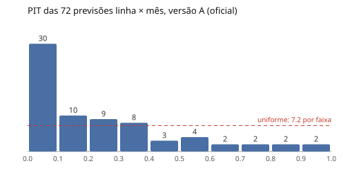
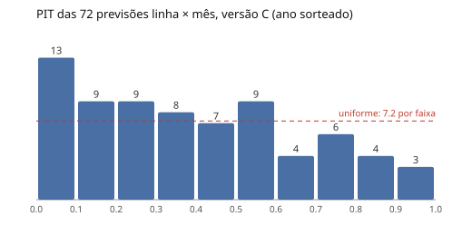

# Validação contra o histórico (spec 012)

Gerado por `pipeline/backtest.py`, semente 20261022, 100 vetores do bootstrap × 20 caminhos. Conta as falhas técnicas (material rodante e equipamentos fixos) nas horas com serviço programado.

O processo previsto é o mesmo do simulador: taxa horária do modelo da spec 005 ajustado só no treino, com o clima e a oferta observados no teste, e falhas como renovação Weibull no tempo reescalado (spec 006). As durações saem da amostra observada no treino, como no simulador. A incerteza dos parâmetros entra pelo bootstrap em blocos semanais.

> **Refeito em 2026-11, após a revisão (pós-hoc, spec 020).** Mesmo modelo por família da spec 005 e mesmas versões A a D, sobre os dados revistos pelas specs 017 e 018: duração pela faixa oficial da STM e exposição medida até 2026-09. O resultado oficial da spec 012 é o da v1.1.0 (`git show v1.1.0:fontes/verificacao/backtest.md`): na versão A, 66,7% dos casos (48 de 72) dentro do intervalo, fora do critério, e minutos previstos da Azul em 2025 de 2.962 contra 708 observados. O modelo por fonte é comparado com o da v1.1.0 deixando um ano de fora em [`fora_da_amostra.md`](fora_da_amostra.md), e o teste com meses que nenhum dos dois viu é o pré-registrado (spec 020).

## Cobertura do intervalo de predição de 90%

Critério da spec: entre 80% e 98% dos casos linha × mês, no corte em 2024-12 (versão A).

| Versão | Regra | Pré-registrada | Total (IC 95%) | Sem greve | Meses de greve | Fora acima / abaixo | Entre 80% e 98% |
|---|---|---|---|---|---|---|---|
| A | treino até 2024-12; no teste, efeito do ano de 2024 | sim | 65,3% (47/72; 53,1%–76,1%) | 73,2% (41/56) | 37,5% (6/16) | 1 / 24 | não |
| B | treino até 2023-09 (só exposição medida); no teste, efeito do ano de 2023 | sim | 84,7% (61/72; 74,3%–92,1%) | 82,1% (46/56) | 93,8% (15/16) | 3 / 8 | sim |
| C | treino até 2024-12; efeito do ano sorteado entre 2019 e 2024 a cada caminho | não (2026-10-21) | 87,5% (63/72; 77,6%–94,1%) | 85,7% (48/56) | 93,8% (15/16) | 3 / 6 | sim |
| D | reteste da regra C em outro período: treino até 2022-12, teste de 2023-01 a 2024-06 | não (2026-10-21) | 90,3% (65/72; 81,0%–96,0%) | 90,3% (65/72) | — | 4 / 3 | sim |

## Registro de mudança (2026-10-21)

A versão A, definida antes de ver o teste, usa no teste o efeito do último ano de treino. O segundo semestre de 2024 teve cerca de 1.000 falhas técnicas, contra cerca de 500 nos semestres vizinhos (a Amarela teve 403 em 2024, contra 76 a 186 nos demais anos). A versão A herda esse pico. Depois de ver o resultado, registramos a versão C, que sorteia o efeito do ano entre os anos do treino a cada caminho, e, como pede a spec, a testamos de novo num período diferente (versão D). O resultado oficial do critério é o da versão A.

## Cobertura por linha

| Linha | A | B | C | D |
|---|---|---|---|---|
| verde | 55,6% (10/18) | 88,9% (16/18) | 94,4% (17/18) | 100,0% (18/18) |
| laranja | 44,4% (8/18) | 72,2% (13/18) | 83,3% (15/18) | 77,8% (14/18) |
| amarela | 83,3% (15/18) | 94,4% (17/18) | 88,9% (16/18) | 83,3% (15/18) |
| azul | 77,8% (14/18) | 83,3% (15/18) | 83,3% (15/18) | 100,0% (18/18) |

## Onde o modelo falhou (versão A)

| Linha | Meses fora do intervalo (observado contra IP 90%) |
|---|---|
| verde | 2025-05 (16 contra 22–51); 2025-06 (23 contra 25–55); 2025-07 (14 contra 32–64); 2025-08 (23 contra 30–61); 2025-09 (24 contra 33–73); 2025-10 (19 contra 28–59); 2025-11 (19 contra 21–48); 2026-06 (21 contra 29–61) |
| laranja | 2025-04 (17 contra 22–55); 2025-06 (29 contra 33–72); 2025-07 (26 contra 42–88); 2025-08 (22 contra 40–83); 2025-09 (27 contra 46–104); 2025-10 (35 contra 38–81); 2025-11 (21 contra 27–64); 2026-04 (20 contra 22–56); 2026-05 (12 contra 26–61); 2026-06 (22 contra 38–81) |
| amarela | 2025-04 (1 contra 3–27); 2025-08 (3 contra 6–42); 2026-05 (2 contra 3–31) |
| azul | 2025-08 (5 contra 9–31); 2025-09 (7 contra 9–33); 2025-10 (3 contra 8–29); 2026-01 (34 contra 8–27) |

## PIT

- Versão A: histograma em 10 faixas [30, 10, 9, 8, 3, 4, 2, 2, 2, 2]; KS contra a uniforme p = 5.3e-12.
- Versão B: histograma em 10 faixas [15, 7, 8, 7, 5, 7, 7, 7, 2, 7]; KS contra a uniforme p = 0.049.
- Versão C: histograma em 10 faixas [13, 9, 9, 8, 7, 9, 4, 6, 4, 3]; KS contra a uniforme p = 0.011.
- Versão D: histograma em 10 faixas [9, 13, 7, 9, 5, 2, 7, 4, 8, 8]; KS contra a uniforme p = 0.05.

## Minutos parados no primeiro ano do teste

Soma das durações dos eventos técnicos de uma linha nas horas com serviço e dos eventos de causa comum que incluem a linha (sem descontar sobreposições).

| Versão | Ano | Linha | Observado | Mediana prevista | IC 95% | Dentro |
|---|---|---|---|---|---|---|
| A | 2025 | verde | 1363 | 2043 | 1472–2758 | não |
| A | 2025 | laranja | 1160 | 2206 | 1511–3762 | não |
| A | 2025 | amarela | 307 | 645 | 341–1050 | não |
| A | 2025 | azul | 660 | 850 | 508–2918 | sim |
| B | 2025 | verde | 1363 | 1722 | 1215–2419 | sim |
| B | 2025 | laranja | 1160 | 1482 | 971–2079 | sim |
| B | 2025 | amarela | 307 | 368 | 179–655 | sim |
| B | 2025 | azul | 660 | 603 | 416–847 | sim |
| C | 2025 | verde | 1363 | 1586 | 1020–2687 | sim |
| C | 2025 | laranja | 1160 | 1481 | 860–3014 | sim |
| C | 2025 | amarela | 307 | 474 | 220–904 | sim |
| C | 2025 | azul | 660 | 772 | 448–2213 | sim |
| D | 2023 | verde | 1349 | 1717 | 1107–2550 | sim |
| D | 2023 | laranja | 1322 | 1524 | 959–2262 | sim |
| D | 2023 | amarela | 440 | 519 | 265–874 | sim |
| D | 2023 | azul | 643 | 687 | 418–1067 | sim |

## Por família (após a revisão, spec 020)

Falhas por linha × mês de cada família (MR, EF) contra o intervalo de predição de 90% da própria família.

| Versão | MR | EF |
|---|---|---|
| A | 87,5% (63/72) | 65,3% (47/72) |
| B | 86,1% (62/72) | 95,8% (69/72) |
| C | 86,1% (62/72) | 98,6% (71/72) |
| D | 91,7% (66/72) | 87,5% (63/72) |

## Falhas de 5 min ou mais no primeiro ano do teste (após a revisão, spec 020)

Eventos técnicos nas horas com serviço e de causa comum que incluem a linha, com duração de 5 min ou mais (limite do indicador da STM).

| Versão | Ano | Linha | Observado | Mediana prevista | IC 95% | Dentro | MR: observado, IC 95% | EF: observado, IC 95% |
|---|---|---|---|---|---|---|---|---|
| A | 2025 | verde | 81 | 122 | 95–151 | não | 48, 33–64 | 29, 51–98 |
| A | 2025 | laranja | 61 | 127 | 95–163 | não | 20, 11–32 | 37, 74–137 |
| A | 2025 | amarela | 25 | 44 | 24–71 | sim | 20, 4–18 | 4, 13–57 |
| A | 2025 | azul | 48 | 47 | 32–65 | sim | 39, 18–44 | 9, 7–26 |
| B | 2025 | verde | 81 | 103 | 79–132 | sim | 48, 37–75 | 29, 31–66 |
| B | 2025 | laranja | 61 | 87 | 64–112 | não | 20, 12–33 | 37, 43–85 |
| B | 2025 | amarela | 25 | 19 | 10–31 | sim | 20, 4–19 | 4, 2–15 |
| B | 2025 | azul | 48 | 42 | 28–59 | sim | 39, 18–45 | 9, 3–18 |
| C | 2025 | verde | 81 | 98 | 67–157 | sim | 48, 37–99 | 29, 19–83 |
| C | 2025 | laranja | 61 | 81 | 52–149 | sim | 20, 14–47 | 37, 27–118 |
| C | 2025 | amarela | 25 | 31 | 15–62 | sim | 20, 5–25 | 4, 5–45 |
| C | 2025 | azul | 48 | 47 | 29–76 | sim | 39, 21–64 | 9, 2–20 |
| D | 2023 | verde | 113 | 99 | 69–140 | sim | 69, 34–95 | 44, 21–58 |
| D | 2023 | laranja | 101 | 85 | 56–116 | sim | 30, 12–45 | 71, 32–81 |
| D | 2023 | amarela | 32 | 27 | 14–42 | sim | 20, 6–29 | 12, 3–19 |
| D | 2023 | azul | 49 | 47 | 29–74 | sim | 44, 18–62 | 5, 4–18 |

## Minutos por família no primeiro ano do teste (após a revisão, spec 020)

Só eventos técnicos nas horas com serviço; a causa comum fica no total acima.

| Versão | Linha | MR: observado | MR: IC 95% | MR dentro | EF: observado | EF: IC 95% | EF dentro |
|---|---|---|---|---|---|---|---|
| A | verde | 585 | 469–939 | sim | 628 | 803–1945 | não |
| A | laranja | 269 | 184–804 | sim | 741 | 1049–3288 | não |
| A | amarela | 252 | 67–273 | sim | 44 | 159–782 | não |
| A | azul | 517 | 265–616 | sim | 141 | 118–2497 | sim |
| B | verde | 585 | 532–1115 | sim | 628 | 476–1426 | sim |
| B | laranja | 269 | 197–788 | sim | 741 | 590–1386 | sim |
| B | amarela | 252 | 73–315 | sim | 44 | 29–309 | sim |
| B | azul | 517 | 270–629 | sim | 141 | 53–255 | sim |
| C | verde | 585 | 524–1413 | sim | 628 | 272–1579 | sim |
| C | laranja | 269 | 218–1001 | sim | 741 | 372–2328 | sim |
| C | amarela | 252 | 82–368 | sim | 44 | 55–636 | não |
| C | azul | 517 | 294–876 | sim | 141 | 36–1564 | sim |
| D | verde | 795 | 496–1457 | sim | 551 | 346–1357 | sim |
| D | laranja | 568 | 217–1012 | sim | 747 | 464–1402 | sim |
| D | amarela | 252 | 108–475 | sim | 184 | 50–402 | sim |
| D | azul | 551 | 276–848 | sim | 92 | 49–252 | sim |

## Forma da renovação ajustada no treino

- A: verde|MR 0.8129, laranja|MR 0.7369, amarela|MR 0.6809, azul|MR 0.7366, verde|EF 0.7503, laranja|EF 0.6699, amarela|EF 0.4461, azul|EF 0.6552
- B: verde|MR 0.8084, laranja|MR 0.7315, amarela|MR 0.6888, azul|MR 0.7507, verde|EF 0.7709, laranja|EF 0.6695, amarela|EF 0.5207, azul|EF 0.7236
- C: verde|MR 0.8129, laranja|MR 0.7369, amarela|MR 0.6809, azul|MR 0.7366, verde|EF 0.7503, laranja|EF 0.6699, amarela|EF 0.4461, azul|EF 0.6552
- D: verde|MR 0.8123, laranja|MR 0.7264, amarela|MR 0.6757, azul|MR 0.7523, verde|EF 0.7867, laranja|EF 0.6663, amarela|EF 0.5353, azul|EF 0.7363

## Todos os casos da versão A

| Linha | Mês | Observado | Mediana | IP 90% | Dentro | PIT | Greve |
|---|---|---|---|---|---|---|---|
| verde | 2025-01 | 31 | 33 | 21–47 | sim | 0.3937 |  |
| verde | 2025-02 | 32 | 38 | 24–52 | sim | 0.28 |  |
| verde | 2025-03 | 27 | 35 | 22–50 | sim | 0.1645 |  |
| verde | 2025-04 | 23 | 31 | 19–43 | sim | 0.1477 |  |
| verde | 2025-05 | 16 | 36 | 22–51 | não | 0.0034 |  |
| verde | 2025-06 | 23 | 39 | 25–55 | não | 0.0265 | sim |
| verde | 2025-07 | 14 | 46 | 32–64 | não | 0.0 |  |
| verde | 2025-08 | 23 | 45 | 30–61 | não | 0.0015 |  |
| verde | 2025-09 | 24 | 51 | 33–73 | não | 0.0046 | sim |
| verde | 2025-10 | 19 | 42 | 28–59 | não | 0.0028 | sim |
| verde | 2025-11 | 19 | 34 | 21–48 | não | 0.0204 | sim |
| verde | 2025-12 | 37 | 35 | 22–48 | sim | 0.607 |  |
| verde | 2026-01 | 38 | 35 | 23–49 | sim | 0.6256 |  |
| verde | 2026-02 | 35 | 39 | 25–54 | sim | 0.3582 |  |
| verde | 2026-03 | 28 | 37 | 23–51 | sim | 0.1436 |  |
| verde | 2026-04 | 26 | 31 | 19–44 | sim | 0.2782 |  |
| verde | 2026-05 | 25 | 34 | 21–48 | sim | 0.1314 |  |
| verde | 2026-06 | 21 | 44 | 29–61 | não | 0.0039 |  |
| laranja | 2025-01 | 41 | 39 | 23–57 | sim | 0.5816 |  |
| laranja | 2025-02 | 46 | 46 | 28–66 | sim | 0.5138 |  |
| laranja | 2025-03 | 58 | 42 | 26–60 | sim | 0.9331 |  |
| laranja | 2025-04 | 17 | 38 | 22–55 | não | 0.0093 |  |
| laranja | 2025-05 | 30 | 45 | 28–65 | sim | 0.0755 |  |
| laranja | 2025-06 | 29 | 51 | 33–72 | não | 0.02 | sim |
| laranja | 2025-07 | 26 | 63 | 42–88 | não | 0.0021 |  |
| laranja | 2025-08 | 22 | 60 | 40–83 | não | 0.0 |  |
| laranja | 2025-09 | 27 | 74 | 46–104 | não | 0.001 | sim |
| laranja | 2025-10 | 35 | 59 | 38–81 | não | 0.0232 | sim |
| laranja | 2025-11 | 21 | 45 | 27–64 | não | 0.0079 | sim |
| laranja | 2025-12 | 36 | 42 | 25–59 | sim | 0.2759 |  |
| laranja | 2026-01 | 52 | 42 | 26–61 | sim | 0.8218 |  |
| laranja | 2026-02 | 40 | 47 | 28–67 | sim | 0.2821 |  |
| laranja | 2026-03 | 33 | 43 | 26–62 | sim | 0.1612 |  |
| laranja | 2026-04 | 20 | 38 | 22–56 | não | 0.0267 |  |
| laranja | 2026-05 | 12 | 42 | 26–61 | não | 0.0009 |  |
| laranja | 2026-06 | 22 | 58 | 38–81 | não | 0.0011 |  |
| amarela | 2025-01 | 10 | 13 | 3–29 | sim | 0.3454 |  |
| amarela | 2025-02 | 11 | 15 | 4–32 | sim | 0.3314 |  |
| amarela | 2025-03 | 5 | 15 | 4–30 | sim | 0.091 |  |
| amarela | 2025-04 | 1 | 13 | 3–27 | não | 0.018 |  |
| amarela | 2025-05 | 4 | 15 | 3–33 | sim | 0.0771 |  |
| amarela | 2025-06 | 10 | 18 | 4–37 | sim | 0.1903 | sim |
| amarela | 2025-07 | 9 | 22 | 6–42 | sim | 0.0979 |  |
| amarela | 2025-08 | 3 | 22 | 6–42 | não | 0.0139 |  |
| amarela | 2025-09 | 10 | 22 | 5–44 | sim | 0.1341 | sim |
| amarela | 2025-10 | 6 | 17 | 4–35 | sim | 0.1162 | sim |
| amarela | 2025-11 | 4 | 13 | 2–29 | sim | 0.12 | sim |
| amarela | 2025-12 | 6 | 13 | 3–28 | sim | 0.1498 |  |
| amarela | 2026-01 | 10 | 14 | 3–29 | sim | 0.3181 |  |
| amarela | 2026-02 | 17 | 15 | 3–30 | sim | 0.591 |  |
| amarela | 2026-03 | 3 | 13 | 3–28 | sim | 0.055 |  |
| amarela | 2026-04 | 10 | 12 | 2–26 | sim | 0.4013 |  |
| amarela | 2026-05 | 2 | 14 | 3–31 | não | 0.0259 |  |
| amarela | 2026-06 | 14 | 20 | 5–38 | sim | 0.2819 |  |
| azul | 2025-01 | 20 | 16 | 7–27 | sim | 0.729 |  |
| azul | 2025-02 | 13 | 17 | 8–28 | sim | 0.2503 |  |
| azul | 2025-03 | 13 | 17 | 8–28 | sim | 0.2576 |  |
| azul | 2025-04 | 15 | 14 | 6–24 | sim | 0.5716 |  |
| azul | 2025-05 | 13 | 16 | 7–26 | sim | 0.311 |  |
| azul | 2025-06 | 13 | 17 | 8–28 | sim | 0.2591 | sim |
| azul | 2025-07 | 10 | 20 | 10–32 | sim | 0.0563 |  |
| azul | 2025-08 | 5 | 19 | 9–31 | não | 0.0071 |  |
| azul | 2025-09 | 7 | 20 | 9–33 | não | 0.0176 | sim |
| azul | 2025-10 | 3 | 17 | 8–29 | não | 0.0022 | sim |
| azul | 2025-11 | 18 | 14 | 6–24 | sim | 0.7747 | sim |
| azul | 2025-12 | 23 | 17 | 7–27 | sim | 0.8276 |  |
| azul | 2026-01 | 34 | 17 | 8–27 | não | 0.9937 |  |
| azul | 2026-02 | 17 | 18 | 9–29 | sim | 0.4331 |  |
| azul | 2026-03 | 15 | 18 | 9–29 | sim | 0.3241 |  |
| azul | 2026-04 | 11 | 15 | 7–25 | sim | 0.2726 |  |
| azul | 2026-05 | 13 | 15 | 6–26 | sim | 0.3199 |  |
| azul | 2026-06 | 18 | 19 | 9–31 | sim | 0.4691 |  |
