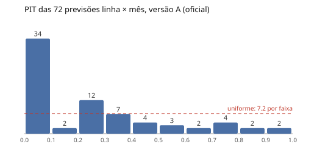
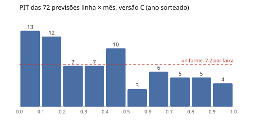

# Validação contra o histórico (spec 012)

Gerado por `pipeline/backtest.py`, semente 20261022, 100 vetores do bootstrap × 20 caminhos. Conta as falhas técnicas (material rodante e equipamentos fixos) nas horas com serviço programado.

O processo previsto é o mesmo do simulador: taxa horária do modelo da spec 005 ajustado só no treino, com o clima e a oferta observados no teste, e falhas como renovação Weibull no tempo reescalado (spec 006). As durações saem da amostra observada no treino, como no simulador. A incerteza dos parâmetros entra pelo bootstrap em blocos semanais.

## Cobertura do intervalo de predição de 90%

Critério da spec: entre 80% e 98% dos casos linha × mês, no corte em 2024-12 (versão A).

| Versão | Regra | Pré-registrada | Total (IC 95%) | Sem greve | Meses de greve | Fora acima / abaixo | Entre 80% e 98% |
|---|---|---|---|---|---|---|---|
| A | treino até 2024-12; no teste, efeito do ano de 2024 | sim | 66,7% (48/72; 54,6%–77,3%) | 69,6% (39/56) | 56,2% (9/16) | 2 / 22 | não |
| B | treino até 2023-09 (só exposição medida); no teste, efeito do ano de 2023 | sim | 81,9% (59/72; 71,1%–90,0%) | 80,4% (45/56) | 87,5% (14/16) | 4 / 9 | sim |
| C | treino até 2024-12; efeito do ano sorteado entre 2019 e 2024 a cada caminho | não (2026-10-21) | 84,7% (61/72; 74,3%–92,1%) | 82,1% (46/56) | 93,8% (15/16) | 3 / 8 | sim |
| D | reteste da regra C em outro período: treino até 2022-12, teste de 2023-01 a 2024-06 | não (2026-10-21) | 90,3% (65/72; 81,0%–96,0%) | 90,3% (65/72) | — | 4 / 3 | sim |

## Registro de mudança (2026-10-21)

A versão A, definida antes de ver o teste, usa no teste o efeito do último ano de treino. O segundo semestre de 2024 teve cerca de 1.000 falhas técnicas, contra cerca de 500 nos semestres vizinhos (a Amarela teve 403 em 2024, contra 76 a 186 nos demais anos). A versão A herda esse pico. Depois de ver o resultado, registramos a versão C, que sorteia o efeito do ano entre os anos do treino a cada caminho, e, como pede a spec, a testamos de novo num período diferente (versão D). O resultado oficial do critério é o da versão A.

## Cobertura por linha

| Linha | A | B | C | D |
|---|---|---|---|---|
| verde | 66,7% (12/18) | 88,9% (16/18) | 94,4% (17/18) | 100,0% (18/18) |
| laranja | 44,4% (8/18) | 83,3% (15/18) | 83,3% (15/18) | 77,8% (14/18) |
| amarela | 77,8% (14/18) | 77,8% (14/18) | 77,8% (14/18) | 83,3% (15/18) |
| azul | 77,8% (14/18) | 77,8% (14/18) | 83,3% (15/18) | 100,0% (18/18) |

## Onde o modelo falhou (versão A)

| Linha | Meses fora do intervalo (observado contra IP 90%) |
|---|---|
| verde | 2025-05 (16 contra 21–47); 2025-07 (14 contra 30–63); 2025-08 (23 contra 29–58); 2025-09 (24 contra 29–65); 2025-10 (19 contra 25–54); 2026-06 (21 contra 28–58) |
| laranja | 2025-03 (58 contra 24–56); 2025-04 (17 contra 22–53); 2025-06 (29 contra 31–70); 2025-07 (26 contra 42–87); 2025-08 (22 contra 38–81); 2025-09 (27 contra 43–100); 2025-11 (21 contra 26–61); 2026-04 (20 contra 22–54); 2026-05 (12 contra 25–59); 2026-06 (22 contra 37–79) |
| amarela | 2025-04 (1 contra 4–31); 2025-08 (3 contra 7–44); 2026-03 (3 contra 5–34); 2026-05 (2 contra 4–33) |
| azul | 2025-08 (5 contra 9–31); 2025-09 (7 contra 9–33); 2025-10 (3 contra 7–28); 2026-01 (34 contra 7–27) |

## PIT

- Versão A: histograma em 10 faixas [34, 2, 12, 7, 4, 3, 2, 4, 2, 2]; KS contra a uniforme p = 2.4e-11.
- Versão B: histograma em 10 faixas [15, 6, 5, 11, 6, 9, 5, 4, 5, 6]; KS contra a uniforme p = 0.06.
- Versão C: histograma em 10 faixas [13, 12, 7, 7, 10, 3, 6, 5, 5, 4]; KS contra a uniforme p = 0.01.
- Versão D: histograma em 10 faixas [7, 12, 9, 8, 7, 5, 4, 4, 10, 6]; KS contra a uniforme p = 0.16.

## Minutos parados no primeiro ano do teste

Soma das durações dos eventos técnicos de uma linha nas horas com serviço e dos eventos de causa comum que incluem a linha (sem descontar sobreposições).

| Versão | Ano | Linha | Observado | Mediana prevista | IC 95% | Dentro |
|---|---|---|---|---|---|---|
| A | 2025 | verde | 1450 | 2207 | 1527–3302 | não |
| A | 2025 | laranja | 1698 | 2356 | 1607–3946 | sim |
| A | 2025 | amarela | 307 | 768 | 427–1275 | não |
| A | 2025 | azul | 708 | 2962 | 618–6818 | sim |
| B | 2025 | verde | 1450 | 1736 | 1201–2504 | sim |
| B | 2025 | laranja | 1698 | 1492 | 1012–2182 | sim |
| B | 2025 | amarela | 307 | 468 | 254–803 | sim |
| B | 2025 | azul | 708 | 610 | 413–864 | sim |
| C | 2025 | verde | 1450 | 1658 | 990–2923 | sim |
| C | 2025 | laranja | 1698 | 1598 | 910–3304 | sim |
| C | 2025 | amarela | 307 | 561 | 274–1054 | sim |
| C | 2025 | azul | 708 | 1818 | 493–5544 | sim |
| D | 2023 | verde | 1390 | 1913 | 1190–2822 | sim |
| D | 2023 | laranja | 1492 | 1619 | 985–2404 | sim |
| D | 2023 | amarela | 448 | 559 | 271–942 | sim |
| D | 2023 | azul | 688 | 701 | 436–1117 | sim |

## Forma da renovação ajustada no treino

- A: verde|MR 0.8136, laranja|MR 0.7371, amarela|MR 0.6832, azul|MR 0.7367, verde|EF 0.7535, laranja|EF 0.6705, amarela|EF 0.4525, azul|EF 0.6561
- B: verde|MR 0.8084, laranja|MR 0.7315, amarela|MR 0.6888, azul|MR 0.7507, verde|EF 0.7709, laranja|EF 0.6695, amarela|EF 0.5207, azul|EF 0.7236
- C: verde|MR 0.8136, laranja|MR 0.7371, amarela|MR 0.6832, azul|MR 0.7367, verde|EF 0.7535, laranja|EF 0.6705, amarela|EF 0.4525, azul|EF 0.6561
- D: verde|MR 0.8123, laranja|MR 0.7264, amarela|MR 0.6757, azul|MR 0.7523, verde|EF 0.7867, laranja|EF 0.6663, amarela|EF 0.5353, azul|EF 0.7363

## Todos os casos da versão A

| Linha | Mês | Observado | Mediana | IP 90% | Dentro | PIT | Greve |
|---|---|---|---|---|---|---|---|
| verde | 2025-01 | 31 | 31 | 19–46 | sim | 0.4792 |  |
| verde | 2025-02 | 32 | 34 | 21–47 | sim | 0.4354 |  |
| verde | 2025-03 | 27 | 33 | 20–46 | sim | 0.2385 |  |
| verde | 2025-04 | 23 | 29 | 18–42 | sim | 0.1791 |  |
| verde | 2025-05 | 16 | 33 | 21–47 | não | 0.0087 |  |
| verde | 2025-06 | 23 | 37 | 23–52 | sim | 0.0571 | sim |
| verde | 2025-07 | 14 | 45 | 30–63 | não | 0.0 |  |
| verde | 2025-08 | 23 | 43 | 29–58 | não | 0.0109 |  |
| verde | 2025-09 | 24 | 46 | 29–65 | não | 0.018 | sim |
| verde | 2025-10 | 19 | 39 | 25–54 | não | 0.006 | sim |
| verde | 2025-11 | 19 | 31 | 19–44 | sim | 0.0383 | sim |
| verde | 2025-12 | 37 | 33 | 21–46 | sim | 0.7109 |  |
| verde | 2026-01 | 38 | 33 | 21–47 | sim | 0.7389 |  |
| verde | 2026-02 | 35 | 35 | 22–49 | sim | 0.5046 |  |
| verde | 2026-03 | 28 | 34 | 22–47 | sim | 0.2033 |  |
| verde | 2026-04 | 26 | 29 | 18–41 | sim | 0.3542 |  |
| verde | 2026-05 | 25 | 31 | 20–45 | sim | 0.2097 |  |
| verde | 2026-06 | 21 | 42 | 28–58 | não | 0.0046 |  |
| laranja | 2025-01 | 41 | 38 | 22–55 | sim | 0.6361 |  |
| laranja | 2025-02 | 46 | 43 | 26–62 | sim | 0.6245 |  |
| laranja | 2025-03 | 58 | 40 | 24–56 | não | 0.9572 |  |
| laranja | 2025-04 | 17 | 36 | 22–53 | não | 0.0074 |  |
| laranja | 2025-05 | 30 | 44 | 27–63 | sim | 0.0899 |  |
| laranja | 2025-06 | 29 | 49 | 31–70 | não | 0.0296 | sim |
| laranja | 2025-07 | 26 | 63 | 42–87 | não | 0.0007 |  |
| laranja | 2025-08 | 22 | 58 | 38–81 | não | 0.0001 |  |
| laranja | 2025-09 | 27 | 68 | 43–100 | não | 0.002 | sim |
| laranja | 2025-10 | 35 | 56 | 35–78 | sim | 0.0507 | sim |
| laranja | 2025-11 | 21 | 43 | 26–61 | não | 0.0173 | sim |
| laranja | 2025-12 | 36 | 40 | 24–57 | sim | 0.3377 |  |
| laranja | 2026-01 | 52 | 41 | 24–58 | sim | 0.8502 |  |
| laranja | 2026-02 | 40 | 44 | 27–63 | sim | 0.3558 |  |
| laranja | 2026-03 | 33 | 40 | 25–59 | sim | 0.247 |  |
| laranja | 2026-04 | 20 | 37 | 22–54 | não | 0.0247 |  |
| laranja | 2026-05 | 12 | 41 | 25–59 | não | 0.001 |  |
| laranja | 2026-06 | 22 | 57 | 37–79 | não | 0.0015 |  |
| amarela | 2025-01 | 10 | 16 | 5–32 | sim | 0.2082 |  |
| amarela | 2025-02 | 11 | 18 | 5–35 | sim | 0.2335 |  |
| amarela | 2025-03 | 5 | 17 | 5–33 | sim | 0.0503 |  |
| amarela | 2025-04 | 1 | 15 | 4–31 | não | 0.0082 |  |
| amarela | 2025-05 | 4 | 17 | 4–36 | sim | 0.0487 |  |
| amarela | 2025-06 | 10 | 19 | 5–37 | sim | 0.1629 | sim |
| amarela | 2025-07 | 9 | 24 | 7–46 | sim | 0.0781 |  |
| amarela | 2025-08 | 3 | 23 | 7–44 | não | 0.0131 |  |
| amarela | 2025-09 | 10 | 26 | 7–52 | sim | 0.076 | sim |
| amarela | 2025-10 | 6 | 21 | 5–41 | sim | 0.0604 | sim |
| amarela | 2025-11 | 4 | 17 | 4–34 | sim | 0.0477 | sim |
| amarela | 2025-12 | 6 | 17 | 5–33 | sim | 0.062 |  |
| amarela | 2026-01 | 10 | 17 | 5–34 | sim | 0.2021 |  |
| amarela | 2026-02 | 17 | 19 | 6–36 | sim | 0.4143 |  |
| amarela | 2026-03 | 3 | 17 | 5–34 | não | 0.0199 |  |
| amarela | 2026-04 | 10 | 15 | 4–31 | sim | 0.2475 |  |
| amarela | 2026-05 | 2 | 16 | 4–33 | não | 0.0164 |  |
| amarela | 2026-06 | 14 | 23 | 7–43 | sim | 0.2009 |  |
| azul | 2025-01 | 20 | 16 | 8–26 | sim | 0.7723 |  |
| azul | 2025-02 | 13 | 16 | 7–27 | sim | 0.2531 |  |
| azul | 2025-03 | 13 | 16 | 8–26 | sim | 0.2677 |  |
| azul | 2025-04 | 15 | 14 | 6–24 | sim | 0.5581 |  |
| azul | 2025-05 | 13 | 16 | 7–26 | sim | 0.323 |  |
| azul | 2025-06 | 13 | 16 | 7–27 | sim | 0.2887 | sim |
| azul | 2025-07 | 10 | 21 | 10–32 | sim | 0.0541 |  |
| azul | 2025-08 | 5 | 19 | 9–31 | não | 0.0088 |  |
| azul | 2025-09 | 7 | 19 | 9–33 | não | 0.0231 | sim |
| azul | 2025-10 | 3 | 17 | 7–28 | não | 0.0056 | sim |
| azul | 2025-11 | 18 | 13 | 6–24 | sim | 0.7658 | sim |
| azul | 2025-12 | 23 | 16 | 7–26 | sim | 0.8771 |  |
| azul | 2026-01 | 34 | 16 | 7–27 | não | 0.9972 |  |
| azul | 2026-02 | 17 | 17 | 8–28 | sim | 0.5022 |  |
| azul | 2026-03 | 15 | 17 | 8–27 | sim | 0.3276 |  |
| azul | 2026-04 | 11 | 14 | 6–24 | sim | 0.3181 |  |
| azul | 2026-05 | 13 | 15 | 6–25 | sim | 0.3523 |  |
| azul | 2026-06 | 18 | 19 | 9–30 | sim | 0.4502 |  |
