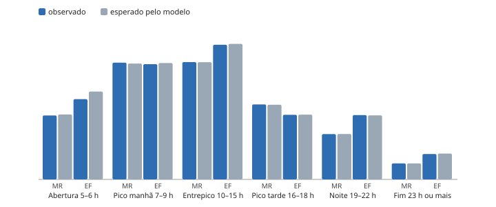

# Observado contra esperado por faixa do dia (spec 005)

Gerado por `pipeline/diagnostico_taxa.py` a partir de `dados/derivados/modelos/painel_modelo.csv.gz`. Esperado = soma da falha esperada pelo modelo escolhido em cada hora-linha. Razão perto de 1 = o modelo acerta o nível da faixa.

| Faixa | Causa | Observado | Esperado | Razão |
|---|---|---|---|---|
| Abertura 5–6 h | MR | 584 | 592,9 | 0,985 |
| Abertura 5–6 h | EF | 733 | 801,8 | 0,914 |
| Pico manhã 7–9 h | MR | 1066 | 1057,8 | 1,008 |
| Pico manhã 7–9 h | EF | 1052 | 1062,6 | 0,990 |
| Entrepico 10–15 h | MR | 1071 | 1070,2 | 1,001 |
| Entrepico 10–15 h | EF | 1229 | 1237,6 | 0,993 |
| Pico tarde 16–18 h | MR | 685 | 682,0 | 1,004 |
| Pico tarde 16–18 h | EF | 590 | 591,5 | 0,998 |
| Noite 19–22 h | MR | 414 | 414,5 | 0,999 |
| Noite 19–22 h | EF | 587 | 584,7 | 1,004 |
| Fim 23 h ou mais | MR | 146 | 146,2 | 0,999 |
| Fim 23 h ou mais | EF | 232 | 236,0 | 0,983 |

## Por linha e faixa (MR + EF)

| Linha | Abertura 5–6 h | Pico manhã 7–9 h | Entrepico 10–15 h | Pico tarde 16–18 h | Noite 19–22 h | Fim 23 h ou mais |
|---|---|---|---|---|---|---|
| verde | 328 / 409 | 816 / 732 | 712 / 770 | 468 / 445 | 310 / 325 | 133 / 115 |
| laranja | 451 / 494 | 754 / 769 | 842 / 854 | 452 / 457 | 386 / 382 | 145 / 143 |
| amarela | 218 / 219 | 231 / 261 | 334 / 289 | 185 / 174 | 137 / 122 | 37 / 62 |
| azul | 320 / 273 | 317 / 359 | 412 / 394 | 170 / 197 | 168 / 171 | 63 / 62 |

Cada célula: observado / esperado.

