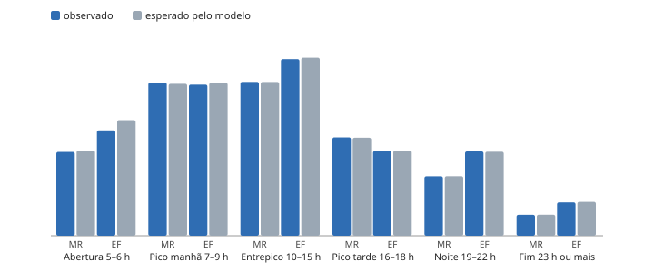

# Observado contra esperado por faixa do dia (spec 005)

Gerado por `pipeline/diagnostico_taxa.py` a partir de `dados/derivados/modelos/painel_modelo.csv.gz`. Esperado = soma da falha esperada pelo modelo escolhido em cada hora-linha. Razão perto de 1 = o modelo acerta o nível da faixa.

| Faixa | Causa | Observado | Esperado | Razão |
|---|---|---|---|---|
| Abertura 5–6 h | MR | 584 | 592,8 | 0,985 |
| Abertura 5–6 h | EF | 733 | 804,4 | 0,911 |
| Pico manhã 7–9 h | MR | 1066 | 1057,5 | 1,008 |
| Pico manhã 7–9 h | EF | 1052 | 1064,4 | 0,988 |
| Entrepico 10–15 h | MR | 1071 | 1070,2 | 1,001 |
| Entrepico 10–15 h | EF | 1229 | 1239,6 | 0,991 |
| Pico tarde 16–18 h | MR | 685 | 682,0 | 1,004 |
| Pico tarde 16–18 h | EF | 590 | 592,7 | 0,996 |
| Noite 19–22 h | MR | 414 | 414,5 | 0,999 |
| Noite 19–22 h | EF | 587 | 585,2 | 1,003 |
| Fim 23 h ou mais | MR | 146 | 146,2 | 0,999 |
| Fim 23 h ou mais | EF | 232 | 236,2 | 0,982 |

## Por linha e faixa (MR + EF)

| Linha | Abertura 5–6 h | Pico manhã 7–9 h | Entrepico 10–15 h | Pico tarde 16–18 h | Noite 19–22 h | Fim 23 h ou mais |
|---|---|---|---|---|---|---|
| verde | 328 / 409 | 816 / 733 | 712 / 770 | 468 / 445 | 310 / 325 | 133 / 115 |
| laranja | 451 / 495 | 754 / 770 | 842 / 855 | 452 / 458 | 386 / 382 | 145 / 143 |
| amarela | 218 / 219 | 231 / 261 | 334 / 290 | 185 / 175 | 137 / 122 | 37 / 62 |
| azul | 320 / 273 | 317 / 358 | 412 / 395 | 170 / 197 | 168 / 171 | 63 / 62 |

Cada célula: observado / esperado.

## Parcela da frota igual em todas as horas (spec 018)

Na Verde, a única linha com as duas frotas, a fração de falhas do MR-73 entre as falhas das duas frotas, por faixa do dia: observada e prevista pelo modelo empilhado, que supõe a mesma parcela de km da frota em todas as horas do dia. Teste: qui-quadrado da soma dos desvios padronizados (binomial) nas faixas, com graus de liberdade = faixas − 1.

| Faixa | Falhas das duas frotas | Fração MR-73 observada | Prevista | Desvio padronizado |
|---|---|---|---|---|
| Abertura 5–6 h | 127 | 0,638 | 0,795 | -4,39 |
| Pico manhã 7–9 h | 503 | 0,849 | 0,805 | +2,50 |
| Entrepico 10–15 h | 376 | 0,787 | 0,788 | -0,02 |
| Pico tarde 16–18 h | 311 | 0,868 | 0,798 | +3,07 |
| Noite 19–22 h | 130 | 0,662 | 0,791 | -3,62 |
| Fim 23 h ou mais | 43 | 0,581 | 0,783 | -3,20 |

Qui-quadrado 58,2 com 5 graus de liberdade, p = 2,8e-11. A hipótese é rejeitada a 5%: a mistura de frotas muda com a hora do dia (o MR-73 pesa mais nos picos). O km real da STM é diário, então a parcela por hora não se mede; a razão MR-73 ÷ MPM-10 fica com essa ressalva.

