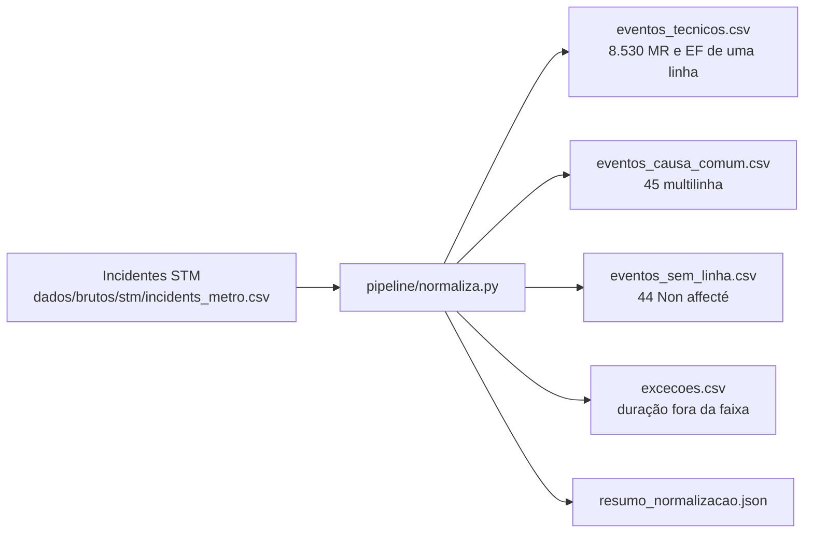

# 001 — Normalização dos incidentes: plano

## Fluxo

## Métodos

| Passo | Método |
|---|---|
| Leitura | CSV com `;`, cabeçalho na linha 2 (a linha 1 é título) |
| Classe técnica | `Cause primaire` em "Matériel roulant" (MR) ou "Équipements fixes" (EF) |
| Linha | Nome da linha → verde, laranja, amarela, azul. Campo com dois ou mais dígitos de linha → causa comum. "Non affecté" → sem linha |
| Início | `Jour calendaire` + `Heure de l'incident`. Hora 24:xx e 25:xx = dia seguinte (minutos contados à mão, sem `strptime`) |
| Fim | A retomada não tem data: duração = (fim − início) mod 1.440 minutos |
| Fuso | Hora local America/Montreal (`zoneinfo`); UTC derivado. Confirmado na spec 003 ao cruzar com o clima |
| Conferência | Duração calculada contra a faixa oficial `Incident en minutes` e a faixa vizinha; fora das duas → `excecoes.csv` com o motivo |
| Reprodutibilidade | Ordem fixa, LF, sem data de geração no arquivo |

## Pontos de falha

| Ponto | Mitigação |
|---|---|
| Retomada sem data esconde interrupção de mais de 24 h | Duração máxima publicada (1.170 min) e lista de exceções |
| Fuso não documentado pela STM | Teste de horário de verão e cruzamento com o clima (spec 003) |
| Mudança do arquivo na origem | Hash no manifesto; a Release guarda o snapshot |
