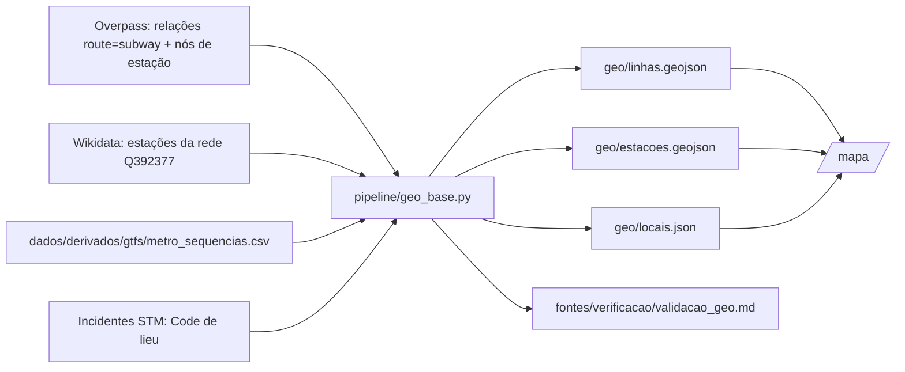

# 002 — Base geoespacial: plano

## Fluxo

## Métodos

| Passo | Método |
|---|---|
| Traçado | Para cada linha (ref 1, 2, 4, 5), usa a relação de menor id e encadeia as vias pelas pontas mais próximas, invertendo as que vierem ao contrário. Orienta o resultado no sentido 0 do GTFS |
| Comprimento | Soma das distâncias haversine entre pontos consecutivos |
| km ao longo da linha | Projeção ortogonal da estação no traçado (aproximação plana local) |
| Casamento de nomes | Normalização (sem acento, maiúsculas, "SAINTE-" → "STE-", "SAINT-" → "ST-", só letras e dígitos) e uma tabela de apelidos conferida um a um (`APELIDOS` no script) |
| Código de estação | Nome igual ao de uma estação do GTFS na mesma linha → "verificado" |
| Código `xSyy` | Tabela `PLATAFORMAS` deduzida das lacunas na numeração Mxyy do GTFS → "deduzido", com teste de coerência |
| `INTER.A/B` | Ponto médio no traçado entre as duas estações → "verificado" quando as duas casam |
| Garagem e arrière-gare | Coordenada da estação de mesmo nome → "aproximado" |
| Subestação, código genérico x999 | Sem posição → "desconhecido", com o tipo registrado |

## Saídas

| Arquivo | Conteúdo | Licença |
|---|---|---|
| `dados/derivados/geo/linhas.geojson` | 4 LineStrings com comprimento OSM, comprimento oficial, relação OSM, cor | ODbL (derivado do OSM) |
| `dados/derivados/geo/estacoes.geojson` | 73 pontos com linha, ordem, km na linha, distância ao traçado, ao OSM e ao Wikidata | CC BY 4.0 (GTFS) |
| `dados/derivados/geo/locais.json` | 201 códigos com tipo, status, coordenada, km, estações, falhas e método | Derivado da STM, CC BY 4.0 |

## Página `/mapa/`

- Mapa de fundo OpenFreeMap (estilo positron, sem chave).
- Traçado colorido pela cor de cada linha no OSM, estações e círculos de área proporcional ao número de falhas.
- Cor do círculo pelo status da posição, filtrável na legenda.
- Clique num círculo mostra código, linha, tipo, status, estações, km e método.
- Atribuição OSM (ODbL), STM e OpenFreeMap visível.
