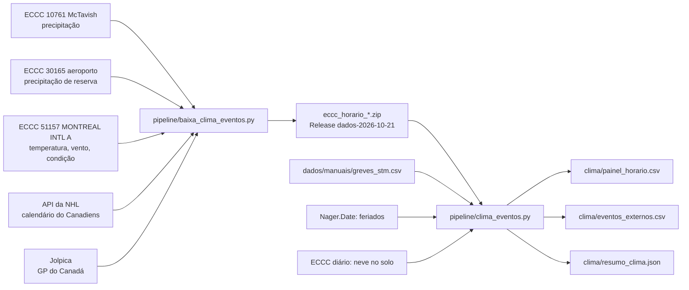

# 003 — Clima horário e eventos externos: plano

## Fluxo

## Métodos

| Passo | Método |
|---|---|
| Download | CSV mensal do ECCC (`timeframe=1`), 90 meses por estação; validado pelo cabeçalho `"Longitude`; novas tentativas em qualquer erro de rede |
| Empacotamento | Um zip por estação com data fixa (1980-01-01) e ordem fixa: o hash não muda de uma geração para outra |
| Fuso | LST (UTC−5 fixo) → UTC → America/Montreal com `zoneinfo`; uma linha por hora UTC, sem lacuna nem repetição |
| Dia de operação | 00:00 a 03:59 local pertencem ao dia anterior (horas 24 a 27) |
| Precipitação | 10761; se faltar, 30165; a coluna `estacao_precip` diz qual |
| Condição | Campo "Weather" da 51157; ausente fica vazio, nunca "seco" |
| Jogo | De 1 h antes a 3 h 30 depois do início (hipótese declarada) |
| Greve | Fração da hora com serviço a partir das faixas da imprensa |

## Pontos de falha

| Ponto | Mitigação |
|---|---|
| ECCC devolve página HTML no lugar do CSV | Validação do cabeçalho antes de gravar; arquivo parcial nunca substitui o bom |
| Leitura incompleta do servidor (`IncompleteRead`) | Tratada como erro de rede, com nova tentativa (ocorreu em 2026-10-21) |
| API da NHL muda sem aviso | Resposta guardada com hash; status "origem" |
| Condição ausente em 54% das horas | Categoria "sem_dado" no modelo da spec 005 |
