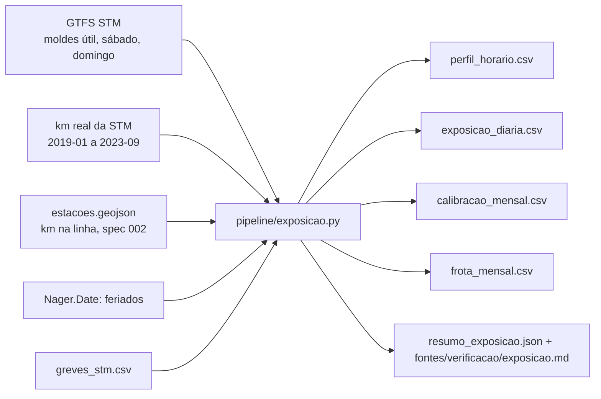

# 004 — Exposição: plano

## Fluxo

## Métodos

| Passo | Método |
|---|---|
| Perfil horário | Para cada viagem do molde, a parte da viagem dentro de cada hora soma em trens-hora; o trem-km entra na mesma proporção |
| Tipo de dia | Útil, sábado ou domingo; feriado usa o molde de domingo |
| Fator do dia | km real do dia ÷ vagões por trem ÷ trem-km do molde (status "medido") |
| Depois de 2023-09 | Mediana do fator de 2022-10 a 2023-09, mesma linha e tipo de dia (status "estimado") |
| Calibração do critério | Fator por linha e período de exploração; erro mensal do km estimado contra o real |
| Frota | Parcela de MPM-10, MR-73 e MR-63 no km da linha por mês; depois de 2023-09, a parcela de 2022-10 a 2023-09 |
| Greve | Exposição da hora × fração da hora com serviço (spec 003) |

## Pontos de falha

| Ponto | Mitigação |
|---|---|
| O GTFS é de 2026, não do período histórico | Fator diário medido até 2023-09; erro mensal publicado |
| Abril de 2020: a oferta mudou no meio do mês | Registrado como exceção, sem afrouxar o critério |
| Vagões por trem diferentes por frota na Verde | Média por linha; erro mensal mediano de 0,44% mostra o efeito pequeno |
