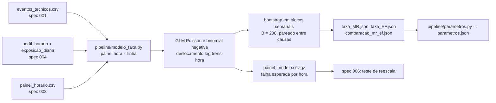

# 005 — Modelo da taxa de falha: plano

## Fluxo

## Base do modelo

Uma linha por dia de operação × linha × hora (05h a 01h), só nas horas com exposição positiva: 226.658 horas-linha. Resposta: número de falhas MR ou EF que começaram na hora. Deslocamento: log(trens-hora do molde × fator do dia × fração com serviço). As 141 falhas em horas sem serviço programado (16 MR, 125 EF, quase todas antes das 05:00) ficam fora e são declaradas.

## Covariáveis (referência entre parênteses)

| Fator | Níveis |
|---|---|
| Linha | verde, amarela, azul (laranja) |
| Faixa do dia | abertura 5–6 h, pico da manhã 7–9 h, pico da tarde 16–18 h, noite 19–22 h, fim 23 h ou mais (entrepico 10–15 h) |
| Tipo de dia | sábado, domingo (útil) |
| Estação do ano | inverno, primavera, verão (outono) |
| Temperatura | abaixo de −15, −15 a −5, −5 a 5, 15 a 25, 25 ou mais, sem dado (5 a 15 °C) |
| Precipitação | até 1 mm, acima de 1 mm, sem dado (zero) |
| Condição | chuva, neve, chuva congelante, sem dado (seco ou outra) |
| Neve no solo | 1 a 10 cm, acima de 10 cm, sem dado (zero; de junho a setembro, ausente vale zero) |
| Ano | 2020 a 2026 (2019) |
| Indicadores | jogo do Canadiens, fim de semana do GP, feriado, greve |

## Métodos

| Passo | Método |
|---|---|
| Poisson | GLM com ligação log |
| Binomial negativa (NB2) | α por verossimilhança perfilada: GLM com α fixo numa grade de 0,01 a 20 em escala log e refinamento limitado. O ajuste direto do `statsmodels.discrete.NegativeBinomial` não convergiu nesta base |
| Escolha | Menor AIC e razão de verossimilhança com metade de qui-quadrado com 1 grau (α = 0 está na fronteira) |
| Intervalos | Bootstrap em blocos semanais (semana ISO do dia de operação), B = 200, α fixo; nível ausente numa reamostra vira lacuna, não multiplicador 1 |
| MR contra EF | Mesma semente nas duas causas: as reamostras usam as mesmas semanas, e a razão dos multiplicadores tem IC pareado |
| Resíduos | Quantílicos aleatorizados (Dunn-Smyth) e rootograma (horas com 0, 1, 2 e 3+ falhas) |
| Robustez | Mesmo modelo só no período com km real (até 2023-09); termo de defasagem (falha na hora anterior) |
| Taxa-base para o simulador | exp(intercepto + linha + ano 2025): falhas por trem-hora nas condições de referência, com IC do mesmo bootstrap |

## Pontos de falha

| Ponto | Mitigação |
|---|---|
| Matriz sem posto completo | Conferência do posto antes do ajuste; erro explícito se faltar |
| Memória (226 mil × 41) | Uma cópia da matriz; coleta de lixo a cada 20 reamostras (houve falta de memória em 2026-10-21 com outros processos abertos) |
| Exposição estimada depois de 2023-09 | Comparação com o ajuste só no período medido |
| Condição ausente em 54% das horas | Nível "sem dado" próprio |
