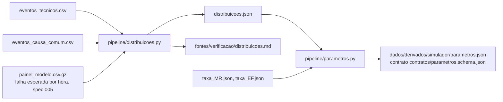

# 006 — Tempo entre falhas, tempo até restabelecer e causa comum: plano

## Fluxo

## Métodos

| Passo | Método |
|---|---|
| Tempo de operação | 20 h por dia de serviço (05:00 a 01:00); intervalos com piso de 1 minuto |
| Estratos | linha × causa; × frota no material rodante (intervalos da mesma frota); × condição (inverno de dezembro a fevereiro ou resto do ano, pelo mês da falha que fecha o intervalo) |
| Candidatas | exponencial, Weibull, gama, lognormal, log-logística, com origem em zero, por máxima verossimilhança |
| Escolha | Menor AIC; ΔAIC de todas publicado |
| Aderência | KS e Anderson-Darling do melhor modelo, com p-valor por bootstrap paramétrico (reajuste a cada reamostra: correção de Lilliefors) |
| Estrato pequeno | Menos de 30 intervalos: herda o modelo do estrato pai (linha × causa) |
| Reescala do tempo | Λ(t) acumulado da falha esperada por hora (spec 005), com interpolação dentro da hora; intervalos reescalados contra Exp(1) por KS; se p ≤ 0,05, renovação Weibull no tempo reescalado (forma e escala com IC por bootstrap) |
| Tempo até restabelecer | Massa em zero (IC de Wilson) + lognormal das durações positivas (IC de μ e σ por bootstrap); regressão de tempo acelerado lognormal com linha, causa secundária, faixa do dia e evacuação |
| Sorteio no simulador | Desde 2026-10-21: massa em zero + amostra observada das durações positivas (reamostragem); a lognormal ficou para o tempo acelerado |
| Causa comum | β = eventos comuns ÷ (comuns + independentes) com IC de Clopper-Pearson; taxa por hora de operação com IC exato de Garwood; duração com massa em zero e lognormal |
| Contrato | `pipeline/parametros.py` junta tudo em `parametros.json`; cada número leva valor, IC, n, unidade, método, fontes, script e status |

## Pontos de falha

| Ponto | Mitigação |
|---|---|
| Intervalos empatados no piso de 1 minuto | KS conservador; documentado |
| Intervalos que atravessam a troca de estação | Classificados pelo fim; a série completa da linha continua publicada |
| Teste de reescala depende do modelo 005 | Média dos intervalos reescalados publicada (perto de 1 em todas as linhas) |
