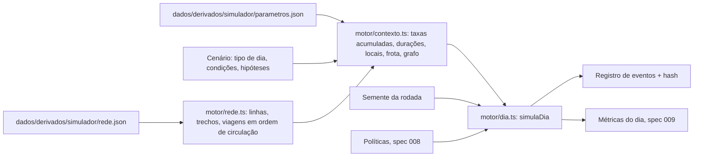

# 007 — Motor de simulação por eventos discretos: plano

## Fluxo

## Desenho

| Peça | Como funciona | Arquivo |
|---|---|---|
| Sorteio | xoshiro128** com semente. Um fluxo por fonte de sorteio (falhas MR, falhas EF, causa comum, durações, escolha de trem e local, frota, políticas), separado por linha ou par. A semente de cada fluxo deriva da semente da rodada | `app/src/motor/prng.ts` |
| Fila de eventos | Heap binário de mínimo; empate na hora desfeito pela ordem de inserção | `app/src/motor/heap.ts` |
| Taxa | λ(t) = taxa-base por trem-hora × Π multiplicadores das condições da hora × trens em circulação no horário, minuto a minuto. Faixa horária e tipo de dia vêm do relógio; os outros fatores do cenário ou do nível de referência | `app/src/motor/taxas.ts` |
| Instantes de falha | Renovação Weibull no tempo reescalado Λ(t). Forma 1 é Poisson com taxa variável. O primeiro intervalo é o residual de equilíbrio: (X/escala)^forma ~ Gama(1 + 1/forma), vezes uma uniforme | `app/src/motor/taxas.ts` |
| Movimento dos trens | Recursão max-plus por linha-sentido: a partida de um trem num trecho é o máximo entre o horário, a chegada à estação, a entrada do trem da frente mais o intervalo mínimo e a saída do trem da frente do bloco (um trem por trecho e sentido, incluindo a plataforma de chegada). Um bloqueio impede a entrada e segura quem está dentro do trecho pelo tempo que durar | `app/src/motor/dia.ts` (`calculaTrajetorias`) |
| Ordem de circulação | Ordenação topológica das viagens: em cada trecho vale a ordem de entrada do horário. Viagens curtas (Laranja até Henri-Bourassa) entram na posição certa | `app/src/motor/rede.ts` |
| Falha de trem (MR) | Sorteia uma viagem entre as que circulam na simulação naquele instante. O trem para onde está e bloqueia o trecho no sentido dele pela duração sorteada (massa em zero p_zero; senão lognormal em minutos) | `app/src/motor/dia.ts` |
| Falha de equipamento fixo (EF) | Local sorteado de `locais_ef[linha]` pelo peso, ou uniforme ao longo da linha para as falhas sem posição (`locais_ef_sem_posicao`). km → trecho. Bloqueia 1 ou 2 sentidos (`sentidos_bloqueio_ef`) | `app/src/motor/dia.ts` |
| Causa comum | Evento único por par de linhas, taxa constante por hora de operação na interseção das janelas das duas linhas. Bloqueia as duas linhas inteiras, nos dois sentidos | `app/src/motor/dia.ts` |
| Registro | Cada evento: hora, linha, viagem, trecho físico, sentido, tipo, fluxo de sorteio, posição do sorteio no fluxo, duração e detalhe. Hash FNV-1a de 32 bits sobre a serialização canônica | `app/src/motor/dia.ts` |

## Convenção de índices

- **Índice global:** posição da estação em `rede.json` (ordem do sentido 0).
- **Índice local:** posição ao longo do próprio sentido. No sentido 0, local = global. No sentido 1, o local L é a estação global n − 1 − L. É o referencial em que `inicio` e as paradas das viagens já vêm do `pipeline/horario_simulador.py` (`passos = [n-1-i for i in idx]`).
- **Trecho físico g:** entre as estações globais g e g + 1. No sentido 1, o trecho local j é o físico n − 2 − j (`trechoFisico`). O registro usa sempre o trecho físico.

## Tipos de evento

`FALHA_TREM`, `FALHA_EF`, `CAUSA_COMUM`, `FIM_INTERRUPCAO`, `RETIRADA`, `DEGRADADA_INICIO`, `DEGRADADA_FIM`, `CANCELAMENTO`, `INJETA_RESERVA`, `SEM_TREM` (falha de trem sorteada sem trem em circulação) e `ATRASO` (viagem com mais de 3 min de atraso no terminal).

## Desvios do desenho pedido

| Desvio | Por quê |
|---|---|
| A escala da renovação é normalizada para média 1 no tempo reescalado (escala = 1 / Γ(1 + 1/forma)); a escala do arquivo fica só registrada | Assim o número esperado de falhas é o do modelo de taxa da spec 005. A escala ajustada nos intervalos reescalados já fica perto disso (verde MR: média 0,98 no parametros.json real) |
| O bloco inclui a plataforma de chegada: o trem seguinte só entra no trecho depois que o da frente saiu da estação seguinte | Sem isso, dois trens podem ocupar a mesma plataforma quando o da frente está retido. O horário atual respeita a regra em todos os trechos (conferido: nenhuma violação nos três tipos de dia) |
| A ordem de entrada em cada trecho é a do horário, mesmo com atraso | Viagem curta que entra no meio da linha espera o trem atrasado que vinha antes dela no horário. Simplificação declarada |
| Viagem do GTFS = trem. Não há encadeamento de viagens num mesmo trem (o rede.json não traz `block_id`) | O efeito de um trem retirado sobre as viagens seguintes fica na camada de frota (spec 008) |
| Métrica de interrupção = união dos intervalos com algum bloqueio na linha, recortada na janela de serviço | É a definição do pedido; atraso sem bloqueio não conta como interrupção, mas entra em trens-hora perdidos |
| Com `semFalhas`, a frota também fica completa | "Falhas desligadas" inclui a falta de trens por avaria |

## Hipóteses

| Nome | Padrão | Faixa | Onde |
|---|---|---|---|
| `intervalo_minimo_s` | 90 s | 60 a 180 | parametros.json |
| `sentidos_bloqueio_ef` | 2 | 1 ou 2 | parametros.json |
| Um trem por trecho e sentido | — | — | simplificação da spec |

## Desempenho

Um dia útil com falhas sorteadas leva cerca de 2 ms em Node 22 (5.000 dias em 9,9 s, uma thread, Windows 11, 2026-10-20). Com a máquina carregada por outros processos chegou a 3,6 ms. Sem falhas, 0,2 ms.

## Testes

| Critério | Teste |
|---|---|
| Sem falhas: intervalo por faixa a até 30 s e ponta a ponta a até 1 min | `app/tests/motor/horario.test.ts` (dia útil, sábado e domingo) |
| Trens em viagem às 08:00: 26, 32, 2 e 9 ± 1 | `horario.test.ts` (o motor dá 26, 31, 2 e 9, igual ao GTFS da spec 004) |
| Mesma semente, mesmo hash | `falhas.test.ts` |
| Falha de trem bloqueia o sentido e os trens de trás esperam | `falhas.test.ts` (10 min às 08:00 na Laranja: o trem falho chega 10 min atrasado, mais de 2 viagens atrás atrasam, o outro sentido não) |
| Falha EF em 1 ou 2 sentidos | `falhas.test.ts` (injetada e sorteada com o parâmetro) |
| Causa comum para Verde e Laranja juntas | `falhas.test.ts` |
| Registro com hora, linha, trem, trecho, tipo e origem do sorteio | `falhas.test.ts` |
| Número de falhas sorteadas igual ao da taxa | `falhas.test.ts` (600 dias, a até 8%) |
