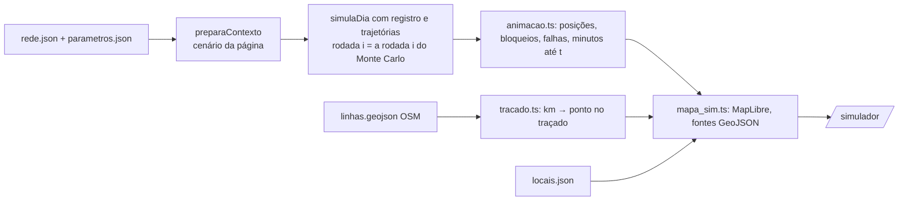

# 010 — Mapa e animação: plano

## Fluxo

## Métodos

| Passo | Método |
|---|---|
| Posição do trem | Na trajetória simulada: parado na estação (chegada ≤ t < partida) ou entre duas estações, com a fração do tempo de percurso; km = km da estação + fração × distância (km das estações da spec 002, medidos sobre o mesmo traçado) |
| Ponto no mapa | Distância acumulada (haversine) ao longo do LineString do OSM; busca binária do segmento e interpolação linear |
| Trecho bloqueado | Eventos FIM_INTERRUPCAO do registro (início = fim − tempo parado de fato); pedaço do traçado entre as duas estações; causa comum = a linha inteira |
| Falha no mapa | Marcador no meio do trecho onde ocorreu, por 5 min simulados ou até a retomada |
| Indicadores | Trens em viagem, bloqueios ativos, falhas até agora e minutos parados por linha (união dos bloqueios, a mesma regra do motor) |
| Tempo | `requestAnimationFrame`; t simulado += Δt real × velocidade (1×, 10×, 60×, 300×); barra para voltar e avançar; clicar numa falha da lista leva para 1 min antes dela |
| Desenho | Só o GeoJSON dos trens muda a cada quadro; bloqueios e falhas só quando o conjunto ativo muda |

## Desempenho (critério de 30 quadros por segundo)

| Medida | Resultado (2026-10-21) |
|---|---|
| Custo do cálculo por quadro no pico (posições de todos os trens, pontos no traçado e bloqueios), `tests/simulador/animacao.test.ts` | 0,10 ms em Node; o orçamento de um quadro a 30 fps é 33 ms |
| Contador de fps na página (canto do mapa) | 60 fps no Chrome sem janela com SwiftShader (WebGL por software), teste de ponta a ponta em 2026-10-21 |
| A conferir pela equipe | fps num notebook comum, com WebGL de verdade, no endereço publicado |

## Decisões

| Ponto | Decisão |
|---|---|
| Worker do MapLibre 6 | O build ESM procura `maplibre-gl-worker.mjs` ao lado do pacote, e o Vite não copia esse arquivo: o mapa falhava com "Worker failed to load". `src/ui/maplibre_worker.ts` empacota o worker (`?worker&url`) e chama `setWorkerUrl`; vale para /mapa/ e /simulador/ |
| Sem WebGL | A página segue sem o mapa (aviso no lugar do mapa) e o resto do simulador funciona |
| Fundo não carrega | O dia e o Monte Carlo não esperam o evento `load` do mapa; o desenho começa quando ele abrir |
| Dois sentidos | Desenhados sobre o mesmo traçado (pergunta em aberto da spec); a cor do trem é a da linha, contorno vermelho com atraso acima de 3 min |
| Uma rodada por vez | O mapa mostra um dia sorteado; o resumo de muitos dias fica na aba "Muitos dias" |
