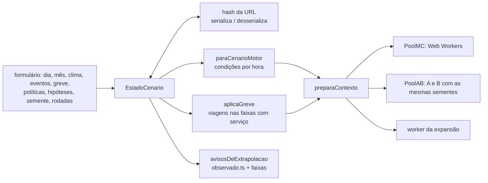

# 011 — Cenários e parâmetros ajustáveis: plano

## Fluxo

## Métodos

| Passo | Método |
|---|---|
| Clima | Cada escolha vira o nível do fator no modelo da spec 005 (estação do ano pelo mês, temperatura, precipitação, condição, neve no solo); a taxa muda só pelos multiplicadores do `parametros.json` |
| Jogo | Indicador ligado nas horas 18 a 22 (jogo às 19h; janela do pipeline: 1 h antes a 3 h 30 depois) |
| Greve | O horário mantém só as viagens que partem nas faixas com serviço (set.–out. ou junho de 2025, `dados/manuais/greves_stm.csv`, status "não verificado"); a oferta menor entra pelo próprio horário, como a exposição da spec 004; o indicador de greve também entra no multiplicador |
| Link | `URLSearchParams` com todos os campos, políticas como bits e hipóteses alteradas como `nome:valor`; valor inválido volta ao padrão |
| Determinismo | A rodada i usa a semente derivada de (semente, i); o mesmo link dá o mesmo cenário e os mesmos números, com qualquer número de workers |
| Extrapolação | Horas observadas de 2019 a 2026 por par de condições (mês × temperatura, temperatura × condição, mês × condição, condição × precipitação, mês × neve no solo, tipo de dia × eventos), contadas em `painel_modelo.csv.gz` e embutidas em `observado.ts`. Zero horas: "extrapolação"; menos de 30: "poucos dados". Hipótese fora da `faixa`: "extrapolação". Multiplicador com IC 95% mais largo que 3×: "incerteza alta" |
| Neve no solo | "Nenhuma" não é conferida: fora do inverno a estação muitas vezes não mede e o pipeline grava "sem dado", não zero |
| Comparação | A fixado; B = cenário atual; `rodaRodadasAB` roda A e B com a mesma semente em cada rodada (números aleatórios comuns); diferença B − A pareada, com IC 95% |
| Resultado ao abrir | Rodada automática de 1.000 dias no cenário padrão (condições de referência) |
| Parâmetros na tela | Valor com IC 95% e status; link para o relatório do script de origem (`fontes/verificacao/`); hipóteses com o selo "hipótese" e a faixa; duração sorteada da distribuição empírica quando o `parametros.json` traz `amostra_positivos` |

## Pontos de falha

| Ponto | Mitigação |
|---|---|
| Parametros.json muda de forma (causa comum por grupo, amostra de durações) | A página lê os campos novos com recuo para os antigos |
| Combinação sem dado | Aviso explícito; o número sai, mas marcado como extrapolação |
| Nenhum número de passageiros | Métricas por oferta (pares de estações ponderados pelas viagens programadas) |
