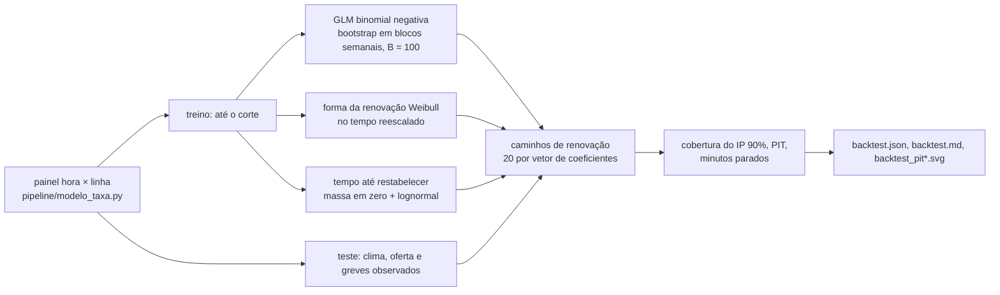

# 012 — Validação contra o histórico: plano

## Fluxo

## Versões

| Versão | Treino | Teste | Efeito do ano no teste | Quando foi definida |
|---|---|---|---|---|
| A (oficial) | até 2024-12-31 | 2025-01 a 2026-06 | o de 2024 (persistência) | antes de ver o teste |
| B | até 2023-09-30 (só exposição medida) | 2025-01 a 2026-06 | o de 2023 | antes de ver o teste (a spec pede a comparação) |
| C | até 2024-12-31 | 2025-01 a 2026-06 | sorteado entre os anos do treino a cada caminho | 2026-10-21, depois de ver A |
| D | até 2022-12-31 | 2023-01 a 2024-06 | sorteado entre os anos do treino | 2026-10-21: reteste de C em outro período, como pede a spec |

## Métodos

| Passo | Método |
|---|---|
| Processo previsto | O do simulador (specs 006 e 007), implementado de novo em Python: taxa horária do GLM × renovação Weibull no tempo reescalado, com escala de média 1 e início estacionário (intervalo com viés de tamanho) |
| Incerteza | Parâmetros: vetores do bootstrap em blocos semanais; processo: 20 caminhos por vetor |
| Cobertura | Fração dos casos linha × mês com o observado dentro do IP 90% (percentis 5 e 95), com IC de Clopper-Pearson |
| PIT | Aleatorizado para contagens: F(y−1) + U·[F(y) − F(y−1)]; histograma em 10 faixas e KS contra a uniforme |
| Minutos parados | Primeiro ano do teste: soma das durações sorteadas (massa em zero + lognormal do treino) e causa comum (Poisson com a taxa do treino) |
| Greve | Meses com greve em 2025 (junho, setembro, outubro e novembro) com cobertura separada |

## Pontos de falha

| Ponto | Mitigação |
|---|---|
| Ano atípico no fim do treino (2024) | Registrado; variante C com reteste em D, sem trocar o resultado oficial |
| Exposição estimada no teste | Versão B compara com o treino só no período medido |
| Memória ao rodar junto com outros ajustes | Rodar sozinho; o bootstrap repete a mesma reamostra em caso de falta de memória |
