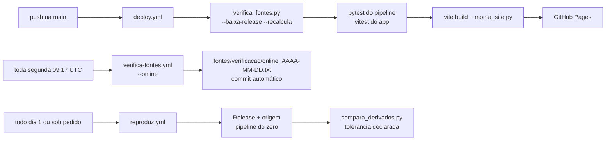

# 013 — Publicação: plano

## Fluxo

## Decisões

| Ponto | Decisão |
|---|---|
| Dados brutos | Releases imutáveis com data no nome (`dados-2026-10-20`, `dados-2026-10-21`); cada fonte guarda a tag da sua Release no manifesto |
| Fonte nova ou atualizada | Nova Release com data; o manifesto passa a apontar para ela; o rodapé do site lista as Releases em uso |
| Fontes sem licença de redistribuição | Status "origem": `verifica_fontes.py --baixa-origem` as baixa na hora; mudança na origem é aviso |
| Tolerância da reprodução | 1e-9 relativo em geral; 1e-3 relativo em `modelos/` e `parametros.json` (bootstrap e otimização variam no último dígito entre plataformas); `codigo_commit` e tempos de execução ignorados |
| Versão congelada | Etiqueta `v1.0.0` no repositório e Release com o zip do site montado; a cada publicação, o deploy desempacota o zip de cada versão congelada em `/versoes/<etiqueta>/`, então o site daquela versão continua acessível |
| Rodapé | Equipe, versão dos dados (Releases) e link para as fontes em todas as páginas |
