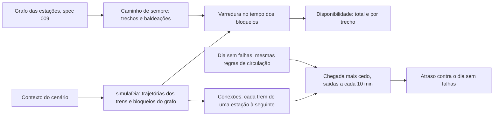

# 015 — Confiabilidade de uma viagem: plano

## Método

| Peça | Como funciona | Arquivo |
|---|---|---|
| Caminho | O caminho mínimo sem falhas do grafo da spec 009 (percurso mediano do horário e baldeação pela hipótese `tempo_transferencia_min`), quebrado em trechos por linha e sentido | `app/src/motor/viagem.ts` (`rotaDoPar`) |
| Bloqueios | O motor já guardava, para a métrica da rede, quais arestas do grafo ficam sem serviço e quando; a opção `bloqueiosOD` os devolve. A varredura no tempo (`segmentosBloqueados`) passou para `grafo.ts` e é a mesma da disponibilidade da rede | `dia.ts`, `grafo.ts` |
| Disponibilidade | Sem rota alternativa, falta caminho quando alguma aresta do caminho de sempre está bloqueada; com ela, quando o Dijkstra com as arestas bloqueadas não liga as estações. Cada trecho conta só as próprias arestas (a disponibilidade do componente, para a conta em série) | `viagem.ts` (`semCaminho`) |
| Atraso | Busca de conexões em ordem de partida (connection scan): seguir no mesmo trem não custa nada, trocar de plataforma custa a baldeação. Sem rota alternativa, só as conexões do caminho de sempre; com ela, todas | `viagem.ts` (`chegadaMaisCedo`) |
| Referência | O mesmo cálculo num dia sem falhas, com as trajetórias do horário pelas regras de circulação do motor (`calculaTrajetorias` sem bloqueios). Assim, sem falhas, o atraso é exatamente zero | `viagem.ts` (`trajetoriasSemFalhas`) |
| Rodadas | A rodada i usa a semente da rodada i do Monte Carlo (o mesmo dia da aba "Muitos dias"); pool de Web Workers com os mesmos lotes; IC95 normal sobre os dias | `viagem.ts` (`rodaViagem`), `simulador/pool_viagem.ts` |

## Desvios e escolhas

- A disponibilidade usa a janela de serviço da rede, como a disponibilidade origem-destino da spec 009; por isso a viagem de um par numa linha só tem a disponibilidade daquele par no grafo, que sem retorno parcial é a da linha inteira.
- O dia sem falhas da referência sai das regras de circulação do motor, não do GTFS cru: o intervalo mínimo entre trens pode atrasar uma partida programada, e esse atraso não é falha.
- Rodadas da viagem não calculam a disponibilidade da rede toda (opção `odDaRede: false`): com a rota alternativa, ela pedia um Dijkstra por origem afetada e triplicava o tempo do dia.
- A montagem das conexões usa índices pré-calculados por linha e ordena um vetor numérico (partida em milissegundos × 2²⁰ + índice): de 24–37 ms para cerca de 4 ms por dia. Sem rota alternativa, só entram as linhas e sentidos do caminho.
