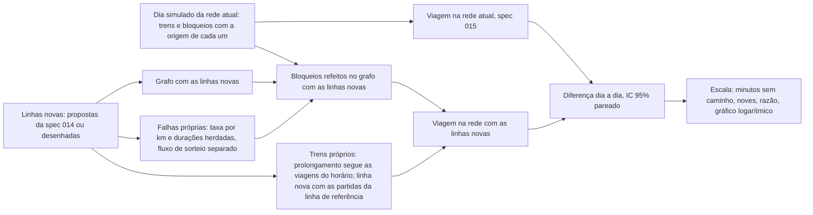

# 016 — Linhas novas numa viagem: plano

## Método

| Peça | Como funciona | Arquivo |
|---|---|---|
| Origem dos bloqueios | Cada bloqueio do grafo guarda a causa, a linha, o trecho e os sentidos (spec 007 sem mudança no sorteio nem no registro) | `app/src/motor/dia.ts`, `grafo.ts` (`OrigemBloqueio`) |
| Grafo com as linhas novas | O mesmo da expansão (`linhasComCandidata`, spec 014): prolongamento estende a linha (o terminal antigo segue ponto de retorno); linha nova é uma linha a mais. As estações da rede atual mantêm os índices | `linhas_novas.ts` (`preparaVariante`), `expansao.ts` |
| Bloqueios refeitos | Falha de material rodante ou de equipamento fixo: o efeito do mesmo trecho no grafo novo (sem retorno parcial, para a linha inteira, inclusive o prolongamento). Causa comum: a linha inteira e, com a opção, as linhas novas que encostam nela | `linhas_novas.ts` (`bloqueiosDaVariante`) |
| Falhas da linha nova | Por trecho: material rodante em cada sentido e equipamento fixo, com a taxa acumulada do dia da linha herdada multiplicada por km do trecho ÷ km da linha (média da rede: soma das linhas ÷ km da rede, durações misturadas com peso pela taxa). Renovação da linha herdada (média da rede: Poisson). Duração sorteada como no motor (`sorteiaDuracao`). Retirada e operação degradada valem. Fluxo `linhas_novas`, com o número pelo nome do trecho: a mesma linha tem as mesmas falhas sozinha ou junto com outras | `linhas_novas.ts` (`falhasDaLinhaNova`), `prng.ts` |
| Trens da linha nova | Prolongamento: cada viagem do horário que chega ao terminal antigo continua pelo trecho novo no horário programado, e a que sai dele vem do trecho novo. Linha nova: as partidas por hora da linha de referência (`herdaTaxasDe`, ou a mais servida entre as que ela encosta), espaçadas por igual, nos dois sentidos. Tempo de percurso: km ÷ velocidade comercial da hipótese | `linhas_novas.ts` |
| Interrupções nos trens | Conexão que cruza um intervalo parado não acontece: os trens novos param com qualquer bloqueio do dia nas suas arestas; os trens da rede atual param também com as falhas das linhas novas (prolongamento sem retorno parcial). Depois, os trens novos seguem o horário, sem fila | `linhas_novas.ts` (`cortesDe`, `cortada`), `viagem.ts` (`conexoesDe`) |
| Medidas | As da spec 015 (disponibilidade, minutos sem caminho, atrasos) e o tempo médio da saída à chegada; na variante, também as falhas da linha nova por dia | `viagem.ts` (`metricasViagemDia`) |
| Comparação pareada | Um dia simulado, medido na rede atual e em cada variante. As métricas da variante k vêm com o prefixo `v{k}.` e as diferenças dia a dia com `d{k}.`; o IC das diferenças é o da média das diferenças | `viagem.ts` (`metricasVariantesDia`, `nomesVariantes`) |
| Escala | Noves = −log₁₀(1 − disponibilidade), com o IC levado pelos extremos. Razão do tempo sem caminho (variante ÷ rede atual) com IC pelo método delta, a covariância tirada da variância da diferença pareada | `app/src/ui/escala.ts` |
| Gráfico | Pontos com intervalo em escala logarítmica (barras em escala log enganam, porque não começam no zero); o zero fica na borda, com marcador vazado | `app/src/ui/graficos.ts` (`graficoPontosLog`) |
| Página | Caixas das propostas, desenho pela lista ou pelo mapa (toque a até 14 px de uma estação conta como a estação; fora, vira estação nova), linhas no link (`ln`, `ld`, `lc`) | `simulador/main.ts`, `mapa_sim.ts`, `cenario.ts` |

## Desvios e escolhas

- **Uma simulação, várias medidas.** A rede atual não é simulada de novo para cada variante: as linhas novas não mudam o que acontece nas linhas atuais, exceto as paradas que causam (prolongamento sem retorno parcial e causa comum compartilhada), que entram como cortes nas conexões. Assim a rede atual é a mesma, bit a bit, em todas as versões, e o ganho sai pareado.
- **Trens novos sem fila.** O motor da spec 007 calcula a fila de trens depois de uma interrupção pela recursão max-plus do horário. A linha nova não tem horário publicado; os trens dela voltam ao horário sintético depois da interrupção. O atraso de quem usa a linha nova fica um pouco otimista depois de paradas longas.
- **Rede atual nos trens do prolongamento.** Sem retorno parcial, uma falha no trecho novo para a linha inteira no grafo; nos trens, as conexões da linha atual durante a parada são cortadas. Depois, os trens da linha atual seguem as trajetórias do dia sem essa falha (sem a fila que ela causaria).
- **Conexões intercaladas.** Com a rota alternativa, as conexões da rede atual do dia são montadas uma vez e reaproveitadas por todas as variantes: troca de índices e intercalação com os trens novos, sem ordenar de novo. Um teste confere que o resultado é idêntico à montagem completa no grafo da variante.
- **Versões medidas.** Cada linha escolhida sozinha e, com duas ou mais, todas juntas. Linhas incompatíveis (duas versões da mesma linha, dois prolongamentos da mesma ponta) não entram juntas, e a página diz por quê.

## Custo

| Medida | Valor | Onde |
|---|---|---|
| Preparo de três variantes (Rosa, linha desenhada e as duas juntas) | 0,6 a 0,8 s por worker | Node, máquina carregada |
| Um dia com rota alternativa, rede atual e três variantes | cerca de 1,8 vez o dia só da rede atual | Node, mesma carga nas duas medidas |
| 200 dias, 4 versões, rota alternativa | 7,4 s (celular) e 24,7 s (notebook) | navegador sem placa de vídeo, 12 workers, com a máquina ocupada por outros programas (CPU em 63% antes de começar) |
