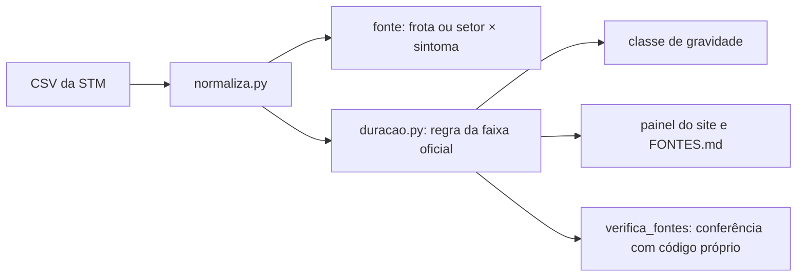

# 017 — Fontes de falha e durações pela faixa oficial: plano

## Método

| Peça | Como funciona | Arquivo |
|---|---|---|
| Fonte | Trem: causa secundária MR-73 → `mr73`, MPM-10 → `mpm10`; veículos de trabalho, "Matériel roulant" e frota com parcela abaixo de 2% do km da linha → `mr_outros`. Fixo: setor × sintoma (`Matériel roulant` = sintoma de trem); a divisão só vale se as duas partes do setor tiverem 400 falhas ou mais na rede | `pipeline/normaliza.py` |
| Parcela da frota na linha | Km real por frota (`Type matériel`) no período medido, por linha | `dados/derivados/exposicao/frota_mensal.csv` (spec 004) |
| Duração | Fora da faixa oficial e da vizinha: sorteio, com semente fixa, entre as durações coerentes da mesma faixa e família, zeros incluídos. Faixa "30 min et plus": a calculada. Também calcula o ponto médio, para a sensibilidade | `pipeline/duracao.py` (novo, usado por `normaliza.py`, `analise_confiabilidade.py` e `monta_painel.py`) |
| Gravidade | Classes < 5, 5–10, 10–30, ≥ 30 min pela duração final; a classe pela faixa oficial ao lado | `pipeline/duracao.py` |
| Colunas novas em `eventos_tecnicos.csv` e `eventos_causa_comum.csv` | `fonte`, `familia`, `duracao_calculada_min`, `regra_duracao` (calculada \| faixa), `virada_de_dia`, `classe_gravidade`, `classe_faixa_oficial`, `cat`, `porta`, `kfs`, `urgencia`, `dano`, `tipo_materiel` | `pipeline/normaliza.py` |
| Relatório | Exceções em contagem e minutos antes e depois, por linha × família; três versões dos minutos; discordância frota × Type de matériel; contagem por fonte e gravidade; lista dos eventos de 300 min ou mais | `fontes/verificacao/fontes_e_duracoes.md` |
| Conferência | Reimplementação curta da regra e das fontes em Python puro, sem pandas | `pipeline/verifica_fontes.py` |

## Escolhas

- **Sorteio dentro da faixa, não ponto médio.** Com o ponto médio, as 29 exceções da faixa "02 min et moins" viravam 1 min, todas positivas, e mudavam a massa em zero. O sorteio entre as coerentes mantém a forma da distribuição dentro da faixa.
- **Semente por falha.** A semente sai do número do incidente, então a duração de cada exceção não depende da ordem do arquivo.
- **Duração final em `duracao_min`.** Os consumidores atuais leem `duracao_min`, então a regra chega a todos sem mudar a leitura; a calculada fica em `duracao_calculada_min`.
- **Mudança dos derivados.** `eventos_tecnicos.csv` muda de hash. O manifesto e a lista de scripts do contrato (`parametros.py`) são atualizados (D43).
